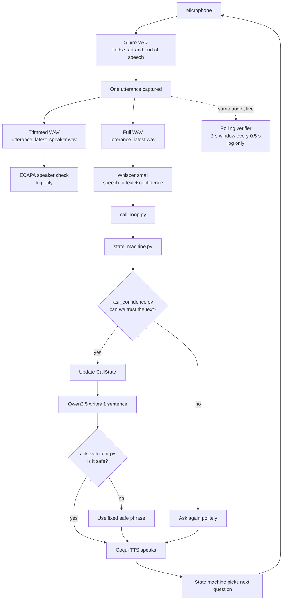
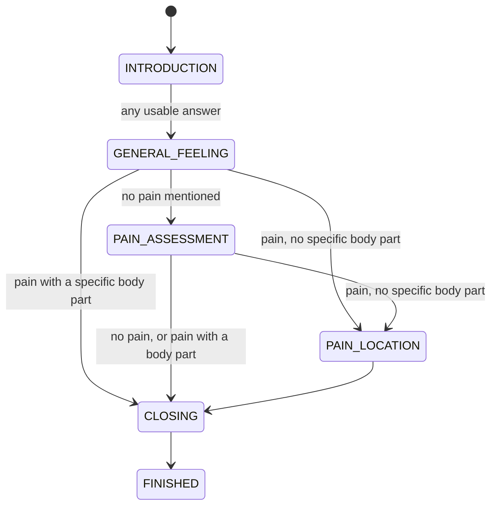

# Patient Follow-up Voice AI Agent

A phone-call style voice assistant that runs **fully on your own computer (CPU only, no cloud)**. It calls a patient, asks a few follow-up questions, listens to the answers, replies with a short kind sentence, and ends the call politely.

This README explains **everything we built, in the order the sound travels**: from the microphone to the final spoken reply. It is written so that someone new (for example a student) can understand the whole system end to end.

> **Important honesty note.** The code and its 129 automated tests were checked with fake models. The real models (Whisper, Qwen, Coqui) were also run live by hand a few times, but we have **not** done a formal accuracy evaluation. Anything marked "not validated" below really is not validated yet.

---

## Table of contents

1. [What the system does (the 60-second version)](#1-what-the-system-does-the-60-second-version)
2. [The big picture](#2-the-big-picture)
3. [Models used (the full names)](#3-models-used-the-full-names)
4. [Project folder map (which file does what)](#4-project-folder-map-which-file-does-what)
5. [Words you need to know (glossary)](#5-words-you-need-to-know-glossary)
6. [Stage 1: Microphone](#6-stage-1-microphone)
7. [Stage 2: VAD and the utterance](#7-stage-2-vad-and-the-utterance)
8. [Stage 3: Saving the utterance (two WAV files)](#8-stage-3-saving-the-utterance-two-wav-files)
9. [Stage 4: Speaker verification (ECAPA, log-only)](#9-stage-4-speaker-verification-ecapa-log-only)
10. [Stage 5: The rolling verifier (the 2-second window)](#10-stage-5-the-rolling-verifier-the-2-second-window)
11. [Stage 6: Speech to text (Whisper) and its confidence numbers](#11-stage-6-speech-to-text-whisper-and-its-confidence-numbers)
12. [Stage 7: The conversation loop (call_loop.py)](#12-stage-7-the-conversation-loop-call_looppy)
13. [Stage 8: The dialogue state machine (state_machine.py)](#13-stage-8-the-dialogue-state-machine-state_machinepy)
14. [Stage 9: The confidence check (asr_confidence.py)](#14-stage-9-the-confidence-check-asr_confidencepy)
15. [Stage 10: The LLM acknowledgment (llm.py)](#15-stage-10-the-llm-acknowledgment-llmpy)
16. [Stage 11: The acknowledgment validator (ack_validator.py)](#16-stage-11-the-acknowledgment-validator-ack_validatorpy)
17. [Stage 12: The call record (call_state.py)](#17-stage-12-the-call-record-call_statepy)
18. [Stage 13: Text to speech (Coqui TTS)](#18-stage-13-text-to-speech-coqui-tts)
19. [Retry limits and error handling](#19-retry-limits-and-error-handling)
20. [A full example call, step by step](#20-a-full-example-call-step-by-step)
21. [The foot / food problem (a known weakness)](#21-the-foot--food-problem-a-known-weakness)
22. [Speaker verification evaluation tools](#22-speaker-verification-evaluation-tools)
23. [How to set up and run](#23-how-to-set-up-and-run)
24. [Tests](#24-tests)
25. [All settings in one table](#25-all-settings-in-one-table)
26. [Known limitations and what is not done](#26-known-limitations-and-what-is-not-done)
27. [Next steps](#27-next-steps)

---

## 1. What the system does (the 60-second version)

1. The agent **speaks** a question ("How have you been feeling recently?").
2. The patient **answers** into the microphone.
3. The system finds **where the patient's sentence starts and ends** (VAD).
4. It **turns the speech into text** (Whisper).
5. It **checks how sure** Whisper was. If the text looks like garbage, it asks again.
6. A **state machine** (plain code, not AI) reads the text and decides the **next question**.
7. A small AI model (**Qwen**) writes **one short kind sentence** ("I'm sorry to hear that.").
8. A **validator** checks that sentence is safe. If not, a fixed safe phrase is used instead.
9. The sentence and the next question are **spoken aloud** (Coqui TTS).
10. Meanwhile a **speaker check** (ECAPA) compares the voice with a saved reference voice. It only **writes to the log**. It never blocks anything.

**Design rule that explains everything:** *code decides what to ask next; the AI only chooses friendly wording; and everything the AI says is checked before it is spoken.* This is because the call is in a healthcare setting, where an AI making up questions or giving advice is unsafe.

---

## 2. The big picture



The same picture as plain text:

```
Microphone -> VAD -> utterance -> [full WAV] -> Whisper -> text + confidence
                          |                                      |
                          |                                      v
                          |                          call_loop -> state machine
                          |                                      |
                          +-> [trimmed WAV] -> ECAPA (log)       +-> confidence check
                          +-> rolling verifier (log)             +-> CallState
                                                                 +-> Qwen -> validator
                                                                 +-> Coqui TTS -> speaker
```

---

## 3. Models used (the full names)

There are **five** models. None needs the internet at run time once downloaded.

| Job | Model (full name) | Size / details | Where in code | Settings |
|---|---|---|---|---|
| Find speech vs silence | **Silero VAD** (`silero-vad` Python package 6.2.3, loaded with `load_silero_vad()`) | Tiny neural network | `audio/utterance_detector.py` | 512-sample windows, speech threshold 0.5 |
| Speech to text | **OpenAI Whisper "small"**, run through **faster-whisper 1.2.1** (CTranslate2 4.8.3) | About 244 million parameters, multilingual | `audio/transcribe.py` | CPU, `int8` (compressed numbers for speed), language forced to English, beam size 5, built-in VAD filter off |
| Voice identity | **ECAPA-TDNN** `speechbrain/spkrec-ecapa-voxceleb` (SpeechBrain 1.1.1), trained on VoxCeleb | Turns a voice into a list of 192 numbers (an "embedding") | `audio/speaker_verification.py` | CPU, 16 kHz audio |
| Wording of the reply | **Qwen2.5-1.5B-Instruct**, `Q4_K_M` GGUF file (about 1066 MB), run with **llama-cpp-python 0.3.36** | 1.5 billion parameters, 4-bit compressed | `dialogue/llm.py` | context 2048, 6 CPU threads, no GPU, temperature 0.3, max 100 tokens |
| Voice of the agent | **Coqui TTS 0.28.0**, model `tts_models/en/vctk/vits`, speaker `p225` | VITS model, 22,050 Hz output | `output/tts.py` | CPU, eSpeak NG used for pronunciation |

Notes:
- "small" is the **name of the Whisper size**, not a vague word. It sits between "base" and "medium" in accuracy and speed.
- Temperature 0.3 means the Qwen model is kept fairly predictable (0 = always the same answer, 1 = very random).
- `models/` also contains `phi-2.Q4_K_M.gguf`, which is **not used**.
- Runtime: Python 3.12 virtual environment, Windows, PyTorch 2.14.1, torchaudio 2.11.0, NumPy 2.5.4, SciPy 1.18.1, sounddevice 0.5.6.

---

## 4. Project folder map (which file does what)

```
speech-ai-agent/
|-- main.py                       <- START HERE. Loads models, runs the call.
|-- reference.wav                 <- the patient's saved reference voice (18.79 s)
|-- audio/                        <- everything about SOUND
|   |-- utterance_detector.py     <- microphone + VAD + saving the utterance
|   |-- rolling_verifier.py       <- the 2 s rolling speaker check (log only)
|   |-- speaker_verification.py   <- ECAPA model, embeddings, cosine similarity
|   |-- transcribe.py             <- Whisper speech to text + confidence numbers
|   |-- vad_detector.py           <- small VAD demo script (not used by main.py)
|   |-- recorder.py, record_test.py, inspect_audio.py, stream_buffer.py
|   |                             <- early helper/experiment scripts, not used by main.py
|-- dialogue/                     <- everything about the CONVERSATION
|   |-- call_loop.py              <- the loop that runs the whole call
|   |-- state_machine.py          <- decides the next question (the "brain")
|   |-- asr_confidence.py         <- "can we trust what Whisper heard?"
|   |-- llm.py                    <- Qwen writes one kind sentence
|   |-- ack_validator.py          <- checks that sentence is safe
|   |-- call_state.py             <- the notes taken during the call
|-- output/
|   |-- tts.py                    <- Coqui TTS: text to spoken audio
|   |-- test_tts.py               <- small TTS test
|-- evaluation/
|   |-- record_session.py         <- helper to record test voices
|   |-- evaluate_speaker.py       <- scores genuine vs impostor recordings
|-- eval_data/, eval_results/     <- recordings list and score results
|-- tests/                        <- 129 automated tests
|-- docs/                         <- extra explanation documents
|-- models/                       <- downloaded Qwen files (git-ignored)
|-- pretrained_models/            <- downloaded ECAPA files (git-ignored)
|-- utterance_history/            <- every captured utterance, saved forever
```

`speech/asr.py`, `speech/speaker.py` and `speech/vad.py` are empty placeholder files.

**Why `audio/` and `dialogue/` are separate:** the audio side never needs to know about questions, and the dialogue side never touches the microphone. That is why the dialogue can be tested with fake audio.

---

## 5. Words you need to know (glossary)

| Term | Plain meaning |
|---|---|
| **Sample** | One number measuring the sound wave at one instant. |
| **Sample rate (16 kHz)** | How many samples per second. We use 16,000 per second. Whisper, Silero and ECAPA all want 16 kHz. |
| **Block / chunk** | What the microphone hands us each time: **1,600 samples = 100 ms**. |
| **WAV file** | A plain, uncompressed audio file. |
| **VAD (Voice Activity Detection)** | A tiny model that answers one question about a short piece of audio: *"is someone speaking right now, or is it silence/noise?"* It gives a probability from 0 to 1. |
| **VAD window** | The short piece VAD looks at: **512 samples = 32 ms**. |
| **Utterance** | **One answer from the patient**: everything from the moment they start speaking until they have been quiet long enough that we decide they finished. "Yes, this is a good time" is one utterance. |
| **Pre-roll** | A little audio kept from *before* speech was detected (5 windows = 160 ms), so the first syllable is not cut off. |
| **Endpointing / end-of-utterance rule** | The rule that decides the patient has finished: **47 silent windows in a row = about 1.5 seconds of quiet**. |
| **Tail** | A little audio kept *after* the last speech in the trimmed speaker file (5 windows = **160 ms, not 5 seconds**). |
| **Rolling window** | A 2-second "sliding frame" over the newest audio, re-checked every 0.5 s. Used only by the speaker check. |
| **Step** | How often the rolling check happens: every 0.5 s. |
| **Tick** | One moment when the rolling check is due (every 0.5 s of audio). |
| **Embedding** | A list of numbers (192 for ECAPA) that describes a voice. Same person should give similar lists. |
| **Cosine similarity** | A way to compare two embeddings. Result is from -1 to 1. Higher means "more alike". |
| **Enrollment / reference** | A recording of the real patient used as the thing to compare against (`reference.wav`). |
| **ASR** | Automatic speech recognition: speech to text. Whisper is our ASR. |
| **Transcript** | The text that Whisper wrote down. |
| **avg_logprob** | Whisper's "how sure am I" number. Closer to 0 = more sure. See [section 11](#11-stage-6-speech-to-text-whisper-and-its-confidence-numbers). |
| **No-speech probability** | Whisper's guess that the audio has no speech at all. 0 = definitely speech, 1 = definitely not. |
| **State machine** | A program that is always in exactly one "stage" (like a board game square) and follows fixed rules to move to the next one. |
| **LLM** | Large language model. Qwen is a small one. |
| **Acknowledgment** | The one short sentence the agent says after an answer, like "I'm sorry to hear that." |
| **Validator** | Code that checks an AI sentence against rules before it is allowed to be spoken. |
| **Fallback** | A fixed, safe phrase used when the AI sentence is rejected. |
| **TTS** | Text to speech. |
| **Log-only (monitoring mode)** | The feature only prints results. It never blocks, trims or filters anything. |

---

## 6. Stage 1: Microphone

**File:** [audio/utterance_detector.py](audio/utterance_detector.py) (function `_capture_audio`)

- The program opens the microphone using the **sounddevice** library: 16,000 samples per second, 1 channel (mono), 16-bit integers.
- The sound card hands over a **block of 1,600 samples (100 ms)** each time. A small helper function (the "callback") puts each block into a **queue** (a waiting line).
- The main loop takes blocks out of the queue and processes them. We do it this way so the microphone is never kept waiting by slow processing.
- The queue holds at most **200 blocks (20 seconds)**. If it is ever full, the new block is thrown away and a **dropped-chunk counter** goes up. That number is printed after each capture so we can notice problems.
- If nobody speaks for **30 seconds** (`CAPTURE_TIMEOUT`), capture gives up and returns "nothing heard".

---

## 7. Stage 2: VAD and the utterance

**File:** [audio/utterance_detector.py](audio/utterance_detector.py) (function `_capture_audio`, lines about 232 to 373)

### What VAD is

**Silero VAD** is a small neural network. You give it **512 samples (32 ms)** and it returns a **speech probability** between 0 and 1. We call it "speech" when the probability is **0.5 or higher** (`VAD_THRESHOLD = 0.5`).

Microphone blocks are 1,600 samples, but VAD needs 512. So the code keeps a leftover buffer (`pending_audio`) and cuts the stream into 512-sample pieces. 1,600 / 512 is not a whole number, so a few samples are carried over to the next block. Nothing is lost.

VAD keeps a little memory between windows. We call `vad_model.reset_states()` at the start of every capture so one answer cannot influence the next.

### What an utterance is and how we capture it

An **utterance** is one patient answer. We build it like this:

```
time ->
 silence silence silence | s p e e c h ... speech | q u i e t  q u i e t ...
 \________/                \_____________________/ \_______________________/
 kept in pre-roll          recording                 counting silent windows
 (last 5 windows)          (every 32 ms window       (stop after 47 in a row)
                            is appended)
```

Step by step:

1. **Waiting.** Every 32 ms window is run through VAD. While nothing is detected, we only remember the **last 5 windows (160 ms)** in the `pre_roll` list. Everything older is forgotten.
2. **Speech starts.** The first window with probability 0.5 or more starts the recording. The recording begins with the 5 pre-roll windows, then the speech window. Message printed: `Speech detected...`
3. **Recording.** Every following window is appended. We note for each window whether VAD called it speech (`speech_flags`).
4. **Counting silence.** A speech window resets the silence counter to 0. A non-speech window adds 1.
5. **Speech ends.** When the counter reaches **47 windows** (47 x 32 ms = 1.504 seconds) we say the patient finished. Message printed: `End of utterance detected.`

So a short pause inside a sentence ("I feel... pretty good") does **not** end the answer, because the counter resets every time speech returns.

**Trade-off:** 1.5 seconds is safe against cutting the patient off, but it is a long, slightly awkward wait before the agent replies. Published systems often use 0.5 to 0.8 seconds. We have **not measured** this on our own calls yet, so it has not been changed.

Every capture also feeds the **same audio** to the rolling verifier (section 10), starting with the pre-roll.

---

## 8. Stage 3: Saving the utterance (two WAV files)

**File:** [audio/utterance_detector.py](audio/utterance_detector.py) (function `save_utterance`)

When the utterance ends, **two** WAV files are written, because two different models want two different things.

| File | What is inside | Who uses it | Why |
|---|---|---|---|
| `utterance_latest.wav` | Everything: pre-roll + speech + the full 1.5 s of ending silence | **Whisper** | Whisper handles silence fine and is happy with the whole sentence. |
| `utterance_latest_speaker.wav` | Pre-roll + speech, cut **160 ms (5 windows) after the last speech window** | **ECAPA** | Long trailing silence dilutes a voice fingerprint and lowers the score. |

Both are also copied with a timestamp into `utterance_history/` (for example `20261112_101530_123456_full.wav`). **These files are never deleted**, so the folder grows forever and contains patient audio. This needs a retention policy before real use.

A dictionary `LAST_CAPTURE_INFO` stores the file paths, total length, speech length and dropped-chunk count so `main.py` can read them.

---

## 9. Stage 4: Speaker verification (ECAPA, log-only)

**Files:** [audio/speaker_verification.py](audio/speaker_verification.py), used from [main.py](main.py)

**Goal:** answer "does this voice sound like the registered patient?"

### How it works

1. **Enrollment (once, at start-up).** `reference.wav` (18.79 s) is loaded and turned into an **embedding** (192 numbers) by the **ECAPA-TDNN** model.
2. **For every utterance,** the trimmed WAV `utterance_latest_speaker.wav` is turned into an embedding the same way.
3. The two embeddings are compared with **cosine similarity**, giving a number from -1 to 1.

### What `load_audio` does before ECAPA

- Converts whole-number audio to decimals between -1 and 1.
- Mixes stereo to mono.
- Replaces any broken numbers.
- Resamples to 16 kHz if needed.
- **Trims leading and trailing silence** by measuring loudness in 20 ms frames (anything quieter than 2% of the loudest frame, with a floor of 0.003, counts as silence) and keeps 150 ms of padding.

### The threshold, and why you must be careful with it

`SIMILARITY_THRESHOLD = 0.1`. It was **copied from our supervisor's script** (`voiceAI_test_v5.py`). It has **not been validated** on our data:
- A score at or above 0.1 is labelled `TARGET`, below it `NON_TARGET`.
- **The score is not a probability.** 0.4 does not mean "40% sure it is the patient".
- The SpeechBrain library's own example threshold is 0.25.
- We have recordings of the real patient (12 genuine files scored between 0.2104 and 0.6247, mean 0.4165). We have **no impostor recordings yet**, so we do not know how well 0.1 separates people. Any threshold chosen now would be a guess.

### Log-only means log-only

The system does **not** reject audio based on the score. If the speaker check fails with an error, the error is caught and the call carries on (`similarity = None`). This is deliberate: an unvalidated check must never stop a real patient from using the system.

### Optional: showing the score on a 0 to 1 scale

Cosine similarity is -1 to 1. To show it as 0 to 1 you can use `(score + 1) / 2`. This is only a display change. It does not make the number a probability.

---

## 10. Stage 5: The rolling verifier (the 2-second window)

**File:** [audio/rolling_verifier.py](audio/rolling_verifier.py)

The utterance check in section 9 happens once, after the patient finishes. The **rolling verifier** checks the voice **continuously while the patient is still speaking**, using the same scheme as our supervisor's script.

### The idea

Keep the **latest 2.0 seconds** of audio (`WINDOW_SEC`). Every **0.5 seconds** of new audio (`STEP_SEC`), compare that 2-second piece with the reference and write the score to the log.

```
audio time ->  0s   0.5s   1.0s   1.5s   2.0s   2.5s   3.0s   3.5s
                                          ^      ^      ^      ^
ticks (every 0.5 s):       t=0.5  t=1.0  t=1.5  t=2.0  t=2.5  t=3.0
                            |      |      |      |      |      |
buffer < 2 s?               yes    yes    yes    no     no     no
result:                  INSUFF. INSUFF. INSUFF. score  score  score
                                                  [0.0-2.0] [0.5-2.5] [1.0-3.0]
```

- Before 2 seconds of audio exist, the state is `INSUFFICIENT_AUDIO`. That is **not** evidence of a different speaker. A short answer like "yes" never fills the window.
- The window "slides": the oldest 0.5 s falls off the back as new 0.5 s arrives.

### Three possible results (`VerificationState`)

| State | Meaning |
|---|---|
| `TARGET` | Score at or above 0.1. |
| `NON_TARGET` | Score below 0.1. |
| `INSUFFICIENT_AUDIO` | Fewer than 2 s of audio so far. No check was run. |

### How it runs without slowing the call

- ECAPA takes roughly **0.5 to 0.6 seconds** per check on this CPU. That is about the same as the 0.5 s step.
- So the check runs in a **background thread** (`background=True`). The microphone loop never waits.
- If a check is still running when the next tick arrives, that tick is **skipped, not queued** (a counter records it). In practice about **one tick per answer is skipped**.
- The thread works on a **copy** of the window, so new audio cannot change it mid-check.
- An **epoch counter** discards results that finish late and belong to an earlier turn.
- `require_turn=True` means audio is only accepted between `begin_turn()` and `end_turn()`. That keeps the agent's own spoken voice (which the microphone can hear) out of the window.
- At the end of every answer a summary line is printed (`ticks`, `inferences`, `TARGET`, `NON_TARGET`, `INSUFFICIENT_AUDIO`, `skipped`, `errors`).

**Observation (a hypothesis, not proven):** the last window of an answer tends to score lowest, probably because it contains the trailing silence.

---

## 11. Stage 6: Speech to text (Whisper) and its confidence numbers

**File:** [audio/transcribe.py](audio/transcribe.py) (function `transcribe_audio_with_confidence`)

**Whisper small** reads `utterance_latest.wav` and returns text. Settings: `language="en"`, `beam_size=5`, `vad_filter=False` (we already did VAD ourselves).

### What is beam search? (why "5")

Whisper writes the sentence one word-piece (token) at a time. At each step it could continue many ways. **Beam size 5** means it keeps the **5 best partial sentences** alive and, at the end, picks the one with the best overall score. A bigger beam is a bit more accurate and slower.

### What comes back

The audio is split by Whisper into **segments**. For each segment Whisper provides two numbers, and our code averages them over all segments:

| Value | Meaning | Good | Bad |
|---|---|---|---|
| **`avg_logprob`** | The average **log probability** of the words Whisper chose. | Close to 0 (for example -0.3 to -0.6) | Very negative (below -1.0) |
| **`avg_no_speech_prob`** | Whisper's estimate that the audio **contains no speech**. | Close to 0 | High (above 0.6) |

Our function returns a dictionary: `text`, `avg_logprob`, `avg_no_speech_prob`, `num_segments`, `duration`.

### What does avg_logprob actually mean?

A log probability is a probability written on a different scale. For each word-piece Whisper chose, it knows how likely it considered that choice. We take the logarithm of that probability and average them.

- `exp(avg_logprob)` gives a rough "typical probability per word-piece".
- Examples: `-0.1` is about 0.90 (very sure), `-0.5` is about 0.61, `-1.0` is about 0.37 (quite unsure).
- **It is not "percent correct".** It measures how sure Whisper is of its own output. A confidently wrong word can still score well. See [section 21](#21-the-foot--food-problem-a-known-weakness).

Typical good answers in our live tests were **-0.35 to -0.65** with no-speech probability **0.05 to 0.23**.

### Why short answers score poorly

A one-word reply like "yes" gives Whisper almost no context, so its average log probability is often bad even when the word is correct. That is why the confidence check **exempts bare yes/no answers** from the log-probability rule.

---

## 12. Stage 7: The conversation loop (call_loop.py)

**File:** [dialogue/call_loop.py](dialogue/call_loop.py) (function `run_conversation`)

`main.py` builds everything and hands it to `run_conversation(agent, listen_fn, report_fn)`. This loop **is the phone call**. It was split out of `main.py` so it can be tested with fake listening and fake speaking, with no microphone or models.

Each round of the loop:

```
while the call is not finished:
    1. If the current question has not been spoken yet -> speak it.
       (If speaking failed twice in a row, the call ends.)
    2. If we are at CLOSING (goodbye said) -> mark FINISHED and stop.
    3. Listen:
         listen_fn()  = capture utterance + speaker check + Whisper
         - If it crashes -> agent.system_error("listening")  (apologise, retry)
         - If nothing usable heard -> agent.handle_no_input() (ask again)
    4. Print diagnostics (the report function).
    5. Give the text and the two Whisper numbers to the state machine:
         agent.process_response(text, confidence)
         - If it crashes -> agent.system_error("dialogue")
    6. agent.turn_succeeded()  -> resets the technical-error counter.
print the final "Call status".
```

Key points:
- **Every failure ends in one of three ways:** ask again, carry on, or end politely. The patient never hears an error message or technical text.
- Exceptions are always printed with a full traceback in the console so developers can fix them.
- `listen()` in `main.py` returns `None` if the transcript contains no letters or digits (for example just a sound), which counts as "nothing heard".

---

## 13. Stage 8: The dialogue state machine (state_machine.py)

**File:** [dialogue/state_machine.py](dialogue/state_machine.py) (class `DialogueStateMachine`)

### What a state machine is

Imagine a board game with five squares. The agent is always on exactly one square. It asks that square's question, reads the answer, and the rules say which square to move to. **The rules are plain code, so the next question is always predictable and safe.** The AI is not allowed to choose it.

### The states and fixed questions

| State | What the agent says |
|---|---|
| `INTRODUCTION` | "Hello! I'm calling for your patient follow-up. Is this a good time to talk?" |
| `GENERAL_FEELING` | "How have you been feeling recently?" |
| `PAIN_ASSESSMENT` | "Are you experiencing any pain or discomfort?" |
| `PAIN_LOCATION` | "Could you describe exactly where the pain or discomfort is?" |
| `CLOSING` | "Thank you for sharing your update. Please follow your clinician's instructions. Goodbye!" |
| `FINISHED` | (call is over) |

### How the next state is chosen



This is the heart of it (`choose_next_state`):

```python
if state is GENERAL_FEELING or PAIN_ASSESSMENT:
    if patient mentions pain:
        if patient names a specific body part:  -> CLOSING        # already told us
        else:                                   -> PAIN_LOCATION  # ask, never assume
    else:
        if state is GENERAL_FEELING:            -> PAIN_ASSESSMENT
        else:                                   -> CLOSING
else:
    follow the fixed order (INTRODUCTION -> GENERAL_FEELING, PAIN_LOCATION -> CLOSING)
```

**What we fixed:** the first version always asked about the ankle, then the toe, then the calf, no matter what the patient said. It could invent body parts the patient never mentioned. Now the agent asks about a body part **only if the patient actually reported pain and did not say where**.

### How the code "reads" the patient's words (simple keyword rules)

There is no medical understanding, only word matching (regular expressions):

- **Pain words** (`PAIN_WORDS`): pain, hurt, ache, sore, discomfort, uncomfortable, cramp, swell/swollen, tender, stiff, throb (and word endings, such as "hurts", "aching").
- **"No pain" patterns** (`NO_PAIN_PATTERNS`): "no pain", "not in pain", "nothing hurts", "I don't have any pain", "pain free", and similar. These are checked **first**, so "no pain" does not count as pain.
- **Specific locations** (`SPECIFIC_LOCATIONS`): ankle, toe, toenail, calf/calves, heel, knee, shin, thigh, hip, back, arch, sole, arm, hand, wrist, shoulder, neck, head, chest, stomach, elbow, finger, incision, wound, scar. **"Foot" and "leg" are left out on purpose** because they are too broad: "pain in my foot" should still get the "where exactly?" question.
- **Normalizing:** before matching, text is lowercased, apostrophes removed, punctuation turned into spaces. So "I don't" becomes "i dont".

### Other things the state machine handles

- **Bare "yes"/"no".** A one-word answer is expanded using the current question (`interpret_response`). "No" at the pain question becomes "No, I am not experiencing any pain or discomfort." "Yes" at the introduction becomes "Yes, this is a good time to talk." This makes the later logic and the LLM prompt unambiguous.
- **Repeat requests.** If the patient says "could you repeat that", "pardon", "I didn't hear", and so on, the agent says "Of course, let me repeat that." and asks the same question again. No acknowledgment, no state change.
- **Unclear pain answer.** If, at the pain question, the answer is neither pain, nor no-pain, nor a clear "I'm fine", the agent asks one neutral follow-up: "Sorry, I didn't quite get that. Could you tell me a bit more about how you're feeling?" This is allowed **once per call**.
- **Speaking safely.** `say()` wraps the TTS. A speech failure is logged and counted, and after 2 in a row the call ends.

### The order of decisions inside `process_response`

1. Call already finished/closing? Ignore.
2. Empty text? Ask again.
3. Repeat request? Repeat the question and stop.
4. **Confidence check** (section 14). Unreliable: ask again, record nothing, say no acknowledgment. Borderline: ask once "could you say that once more?", then accept the second try but mark it as `uncertain`.
5. Expand bare yes/no.
6. Unclear pain answer? One neutral follow-up.
7. Usable answer: reset retry counters, **update the call record** (section 17), **get the acknowledgment** (sections 15 and 16), **speak it**.
8. Choose the next state. If it is `CLOSING`, set status `completed`.

### Known small issues (not fixed yet)

- The "fine" pattern matches the words "no" or "well" anywhere in a sentence, so "I have no idea" counts as "fine".
- The "unclear answer" follow-up is allowed once per call, not once per question.
- Repeat requests are not capped, so a patient could ask for repeats forever.

---

## 14. Stage 9: The confidence check (asr_confidence.py)

**File:** [dialogue/asr_confidence.py](dialogue/asr_confidence.py) (function `assess_transcript`)

**Purpose:** decide whether to trust Whisper's text **before** acting on it. If Whisper is clearly unsure (noise, mumbling, a cough, a TV in the background), the agent asks again instead of replying to words the patient may never have said.

### Inputs and output

Input: `avg_logprob`, `avg_no_speech_prob`, and whether the answer is a bare yes/no.
Output: one of `ok`, `borderline`, `unreliable`.

### The exact rules and ranges

Checked **in this order**:

| Step | Rule | Result |
|---|---|---|
| 1 | no-speech probability **above 0.6** | **UNRELIABLE** (probably noise) |
| 2 | the answer is a bare yes/no | **OK** (short answers naturally score poorly) |
| 3 | avg_logprob **below -1.0** | **UNRELIABLE** |
| 4 | avg_logprob **below -0.8** | **BORDERLINE** |
| 5 | no-speech probability **above 0.4** | **BORDERLINE** |
| 6 | otherwise | **OK** |

A missing number (`None`) is not held against the transcript.

Picture of the two scales:

```
avg_logprob:      -1.5 ........ -1.0 ........ -0.8 ........ -0.5 ........ 0
                   UNRELIABLE   |  BORDERLINE |           OK
                              (below -1.0)  (-1.0 to -0.8)   (above -0.8)

no_speech_prob:    0 ........ 0.4 ........ 0.6 ........ 1
                       OK     | BORDERLINE |  UNRELIABLE
                           (above 0.4)   (above 0.6)
```

### Where the numbers come from (and a warning)

- **-1.0 and 0.6** are **Whisper's own default** rejection thresholds. Whisper itself treats a segment below -1.0 average log probability, or above 0.6 no-speech probability, as a failed decode.
- **-0.8 and 0.4** are **placeholders** that we picked in between "typical good" (-0.35 to -0.65) and "unreliable". They are **not calibrated** and need tuning on recorded real calls. The thresholds are named constants in the file, so they are easy to change.

### What the agent does with each verdict

| Verdict | What the agent does |
|---|---|
| `ok` | Continue normally. |
| `borderline` | Ask once, neutrally: "Sorry, could you say that once more?" plus the question. Accept the second try (but mark it uncertain, so it can fill a blank field in the record but never overwrite a known value). |
| `unreliable` | Do not use the text. Count it as a failed try (see [section 19](#19-retry-limits-and-error-handling)), ask again. |

### The most important limit

This check measures **how unsure Whisper was**, not whether it was **right**. "My food hurts" (said "foot") scored about -0.54 and 0.23, which is "OK", and went straight through.

---

## 15. Stage 10: The LLM acknowledgment (llm.py)

**File:** [dialogue/llm.py](dialogue/llm.py) (function `generate_acknowledgment`)

The Qwen2.5-1.5B-Instruct model is loaded **once** when the file is imported (this takes a while at start-up).

**Its only job:** write **one short, warm sentence** acknowledging what the patient said. It does **not** choose the next question, give advice or remember earlier turns (there is no history).

It is given:
- A **system prompt** (written instructions): be warm and professional; one short sentence; do not ask questions; do not give medical advice, diagnoses or exercise instructions; do not invent details; do not introduce a new topic; respond with empathy to pain and positively to "no pain"; treat "yes"/"no" according to the question.
- **Three examples** (no pain, some pain, good time to talk).
- The **question asked** and the **patient's answer** (after yes/no expansion).

Settings: `temperature=0.3`, `max_tokens=100`, `n_ctx=2048`, 6 CPU threads, no GPU.

**Why not trust it?** A 1.5-billion-parameter model on a CPU is small. It can ask questions, give advice, add details or use the wrong tone even when told not to. That is why the next stage exists.

---

## 16. Stage 11: The acknowledgment validator (ack_validator.py)

**File:** [dialogue/ack_validator.py](dialogue/ack_validator.py) (functions `validate_acknowledgment` and `fallback_acknowledgment`)

**Purpose:** nothing the AI writes is spoken until it passes this check. The check is plain word-matching rules, so it is fast and predictable.

`validate_acknowledgment(ack, patient_text, pain_reported)` returns `(True/False, reason)`.

### What is checked (in this order)

| # | Rule | Rejected when | Why |
|---|---|---|---|
| 1 | Not empty | blank | nothing to say |
| 2 | No leftovers | contains a new line or labels like "Reply:", "Patient:", "Question:", "Assistant:" | the model copied our prompt format |
| 3 | Length | more than **25 words** | should be one short sentence |
| 4 | Sentences | more than **2** sentences | same |
| 5 | No question mark | contains "?" | questions belong to the state machine |
| 6 | Not question-shaped | starts with what/where/when/why/how/who/which/do you/did you/are you/have you/can you/could you/would you/will you/is there/is it/does it | same, even without "?" |
| 7 | No advice | contains words like should, recommend, suggest, advice, "you need to", "try to", "make sure", doctor, nurse, hospital, emergency, medication, ibuprofen, treat, diagnose, prescribe, rest, ice, elevate, stretch, exercise, "don't worry", "it will get better" | no medical advice or reassurance on a health call |
| 8 | No invented body parts or symptoms | mentions a body part or symptom word (foot, ankle, knee, pain, swelling, fever, nausea, and about 60 more) that the **patient did not say** | the AI must not add facts |
| 9 | No invented numbers | contains a number the patient did not say | same |
| 10 | Tone: pain | pain was reported but the reply is cheerful (glad, great, wonderful, happy, good to hear, pleased) | wrong tone |
| 11 | Tone: no pain | no pain was reported but the reply shows sympathy (sorry, sympathy) | wrong tone |
| 12 | Sounds like an acknowledgment | contains none of the acknowledgment words (sorry, glad, hear, understand, thank, appreciate, noted, okay, great, good, wonderful, happy, sounds, "I see", "got it" ...) | it should sound like a response |

Words are compared by a simple **stem** (the word with "ing", "ed" or "s" removed), so "hurts" in the patient's text matches "hurt" in the reply.

### What happens when a reply is rejected

The agent prints `[ack] rejected LLM reply (reason): ...` in the console and speaks a **fixed safe phrase** instead (`fallback_acknowledgment`):

| Situation | Fallback phrase |
|---|---|
| Patient reported pain | "I'm sorry to hear that." |
| Introduction | "Thank you for letting me know." |
| Pain location question | "Thank you for sharing that." |
| Patient reported no pain | "Thank you for letting me know." |
| Anything else | "I understand." |

The same fallback is used if the LLM crashes.

### What it can NOT do

It checks the reply **against the transcript**, not against what the patient really said. If Whisper writes "food" and Qwen repeats "food", the validator sees "food" in the patient's text and passes it. It also cannot check that the sentence is *kind* or *correct*, only that it breaks none of the rules above.

---

## 17. Stage 12: The call record (call_state.py)

**File:** [dialogue/call_state.py](dialogue/call_state.py)

A small structured record of what the call learned. It is held **in memory only**. Nothing is saved to disk or sent anywhere.

```
CallState
|-- patient (PatientInfo)
|     |-- general_feeling     patient's own words, or None
|     |-- pain_reported       True / False / None (None = not known yet)
|     |-- pain_location       e.g. "ankle", or None
|     |-- pain_description    patient's own words, or None
|-- conversation_status       in_progress | completed | ended_no_response | ended_error
|-- clarification_count       how many clarification questions were asked
|-- low_confidence_turns      how many transcripts we did not trust
```

How it is filled in (`update_call_state` in the state machine):
- Only **trusted** transcripts are recorded. Untrusted ones never reach it.
- At `GENERAL_FEELING`, the patient's words are stored as the general feeling (bare "yes"/"no" are not).
- If pain is mentioned, `pain_reported = True`, the description is stored, and the location is filled if a known body-part word is present.
- At `PAIN_ASSESSMENT`, a clear denial sets `pain_reported = False`.
- At `PAIN_LOCATION`, the body-part word is saved as the location (or the patient's own words if none matches). "I'm not sure" never overwrites a location.
- A **borderline** transcript that was accepted may fill an **empty** field but never **overwrite** a known one.

At the end the status shows how the call finished (`completed` is the normal ending).

---

## 18. Stage 13: Text to speech (Coqui TTS)

**File:** [output/tts.py](output/tts.py) (function `speak`)

- Loads **Coqui TTS** model `tts_models/en/vctk/vits` on the CPU, with speaker **`p225`** (one of many voices in the VCTK data set).
- Output is 22,050 Hz audio, played through `sounddevice` and **blocking** (`sd.wait()`), so the agent finishes talking before it starts listening again. This also stops it hearing itself.
- **eSpeak NG** is needed for pronunciation. Its install path (`C:\Program Files\eSpeak NG`) is currently **hard-coded** in the file.
- `speak()` does nothing for empty text.

---

## 19. Retry limits and error handling

All limits are named constants at the top of [dialogue/state_machine.py](dialogue/state_machine.py).

| Problem | Limit | What the agent does |
|---|---|---|
| **No usable answer to one question** (silence, empty text, untrusted transcript) | `MAX_UNUSABLE_ATTEMPTS = 3` | Try 1: "Sorry, I didn't catch that." + the question. Try 2: "Let me try once more. Could you answer in a few simple words?" + the question. Try 3: close the call ("I'm having trouble hearing you right now, so I'll end the call here. We will follow up another time. Goodbye!"). Status = `ended_no_response`. |
| **Technical failure** (microphone, transcription or unexpected error) | `MAX_SYSTEM_ERRORS = 2` in a row | First: "Sorry, I had a small technical problem." + the question. Second: close politely. Status = `ended_error`. |
| **Text-to-speech failure** | `MAX_TTS_FAILURES = 2` in a row | After 2 failures the call ends silently, because the agent cannot talk. Status = `ended_error`. |
| **Borderline transcript** | 1 re-ask per question | Ask once, then accept. |

Counters reset when the problem goes away (for example, a good answer resets the "unusable" counter). The patient never hears exception text; developers see full tracebacks in the console.

---

## 20. A full example call, step by step

This follows the real structure of a live run (wording is simplified).

| # | What happens | File |
|---|---|---|
| 1 | Models load: Silero VAD, Whisper small, ECAPA, Qwen, Coqui. `reference.wav` becomes the reference embedding. | `main.py` and each model file |
| 2 | State `INTRODUCTION`. Agent speaks "Hello! I'm calling ... Is this a good time to talk?" | `call_loop.py`, `tts.py` |
| 3 | Patient says "Yes." VAD finds the start, waits for 47 silent windows, saves two WAVs. | `utterance_detector.py` |
| 4 | ECAPA scores the trimmed WAV and prints a similarity. The rolling verifier printed its own log lines during speech. | `speaker_verification.py`, `rolling_verifier.py` |
| 5 | Whisper returns "Yes." with avg_logprob and no-speech numbers. | `transcribe.py` |
| 6 | Confidence check: bare yes/no, low no-speech, so `ok`. | `asr_confidence.py` |
| 7 | "Yes" is expanded to "Yes, this is a good time to talk." Qwen writes an acknowledgment; the validator passes it; it is spoken. | `llm.py`, `ack_validator.py`, `tts.py` |
| 8 | State moves to `GENERAL_FEELING`. Agent asks "How have you been feeling recently?" | `state_machine.py` |
| 9 | Patient: "I have been feeling good." No pain words, so the next state is `PAIN_ASSESSMENT`. CallState stores the general feeling. | `state_machine.py`, `call_state.py` |
| 10 | Agent asks "Are you experiencing any pain or discomfort?" Patient: "No, I'm not feeling any pain." The "no pain" pattern matches, so `pain_reported = False`, next state `CLOSING`, status `completed`. | `state_machine.py` |
| 11 | Agent says the closing message. Loop marks `FINISHED`. | `call_loop.py` |

### Example: the patient reports pain without a location

1. At `PAIN_ASSESSMENT` the patient says "My foot hurts."
2. "hurts" is a pain word, "foot" is **not** in the specific-locations list, so the next state is `PAIN_LOCATION`.
3. Agent: "Could you describe exactly where the pain or discomfort is?"
4. Patient: "My ankle hurts." `ankle` is saved as the location, then `CLOSING`.

### Example: Whisper is unsure

1. Patient coughs while speaking. Whisper returns a short string with avg_logprob -1.3.
2. `assess_transcript` returns `unreliable`.
3. Nothing is recorded, no acknowledgment is spoken, and the agent says "Sorry, I didn't catch that." plus the question. After three failures in a row, the call ends politely.

### Example: Qwen misbehaves

1. Patient: "No, I'm not experiencing any pain." Qwen replies "That's great! Stretch your ankle daily."
2. The validator rejects it (advice words "stretch", and a body part "ankle" the patient did not say).
3. The fixed phrase "Thank you for letting me know." is spoken.

---

## 21. The foot / food problem (a known weakness)

In one live run the patient said "my foot hurts" and Whisper wrote **"my food hurts"**.

What each part did:

| Layer | Result |
|---|---|
| Whisper | Chose "food" as the best-scoring sentence among its 5 beam candidates. |
| Confidence check | avg_logprob about -0.54 and no-speech about 0.23, so `ok`. Whisper was confident, but wrong. |
| State machine | "hurts" is pain, "food" is not a location, so it asked **"Where exactly is the pain?"** This recovered the situation. |
| Patient | Answered "My ankle hurts." Location saved correctly. |
| LLM and validator | Qwen echoed "food". The validator passed it because "food" was in the patient's text. |

**Result:** the error cost one extra question and one odd sentence. It did **not** put a wrong location into the record, because "food" is not a recognised location.

**What we do not have yet:**
- **Read-back confirmation** ("You said your foot hurts, is that right?").
- **Per-word confidence** (we only use one average number per answer).
- **Vocabulary hints** to push Whisper toward body-part words.
- A **bigger Whisper model** (probably more accurate but slower on CPU).

Other confident mistakes seen in live runs: "recently" heard as "resetting", and "discomfort" heard as "this comfort". The same gap applies.

---

## 22. Speaker verification evaluation tools

**Folder:** [evaluation/](evaluation/)

Because the 0.1 threshold is unvalidated, we built a simple evaluation workflow. It does **not** collect recordings for you; the user records them by hand.

```
python -m evaluation.record_session --label genuine --count 12
python -m evaluation.record_session --label impostor --name spk01 --count 12
python -m evaluation.evaluate_speaker
```

- `record_session.py` records labelled test utterances (genuine = the real patient; impostor = other people).
- `evaluate_speaker.py` scores them against `reference.wav`, prints a simple genuine-versus-impostor table with a summary, and writes `eval_results/results.csv`.
- Current state: 12 genuine recordings (min 0.2104, mean 0.4165, max 0.6247). **No impostor recordings yet**, so nothing can be said about how well the threshold separates people.
- Synthetic (computer-made) test results must **not** be used as evidence of real accuracy.

---

## 23. How to set up and run

> `requirements.txt` is currently **empty**. The exact versions are listed in [section 3](#3-models-used-the-full-names). Writing a proper `requirements.txt` is a next step.

Needed:
1. **Python 3.12** and a virtual environment (`.venv`).
2. Python packages: `silero-vad`, `faster-whisper`, `speechbrain`, `torch`, `torchaudio`, `llama-cpp-python`, `TTS` (Coqui), `sounddevice`, `numpy`, `scipy`.
3. **eSpeak NG** installed at `C:\Program Files\eSpeak NG` (or edit `ESPEAK_PATH` in `output/tts.py`).
4. The Qwen file at `models/qwen2.5-1.5b-instruct-q4_k_m.gguf`.
5. A recording of the patient named `reference.wav` in the project folder.
6. A working microphone and speakers.

Run the agent from the project folder:

```
.venv\Scripts\python.exe main.py
```

Whisper, ECAPA and Coqui models download automatically the first time (internet needed once).

Start-up takes a while because Silero VAD, Whisper, ECAPA, Qwen and Coqui all load into memory before the first question.

**Handy single-file tests:**
```
python -m audio.utterance_detector      # capture one utterance
python -m audio.transcribe              # transcribe utterance_latest.wav
python -m audio.speaker_verification    # compare reference.wav and test.wav
python -m dialogue.state_machine        # type answers by keyboard, no audio
```

---

## 24. Tests

```
.venv\Scripts\python.exe -m unittest tests.test_rolling_verifier
.venv\Scripts\python.exe -m unittest tests.test_capture_integration
.venv\Scripts\python.exe -m unittest tests.test_simple_evaluation
.venv\Scripts\python.exe -m unittest tests.test_dialogue_flow
.venv\Scripts\python.exe -m unittest tests.test_dialogue_robustness
```

(`tests/` has no `__init__.py`, so use `python -m unittest tests.<module>`.)

| Test file | Tests | Covers |
|---|---|---|
| `test_rolling_verifier.py` | 32 | window, ticks, skipping, threads, turn gating |
| `test_capture_integration.py` | 14 | VAD capture with the verifier attached |
| `test_simple_evaluation.py` | 21 | speaker evaluation scoring and tables |
| `test_dialogue_flow.py` | 13 | the questions and state changes |
| `test_dialogue_robustness.py` | 49 | confidence, validator, CallState, retries, errors |
| **Total** | **129** | |

**What the tests prove:** the logic behaves as designed, using **fake** models. **What they do not prove:** that real speech, real Whisper, Qwen and Coqui behave well on real patients.

---

## 25. All settings in one table

| Setting | Value | File |
|---|---|---|
| Sample rate | 16,000 Hz | all audio files |
| Microphone block | 1,600 samples (100 ms) | `utterance_detector.py` |
| Queue size | 200 blocks | `utterance_detector.py` |
| Capture timeout | 30 s | `utterance_detector.py` |
| VAD window | 512 samples (32 ms) | `utterance_detector.py` |
| VAD speech threshold | 0.5 | `utterance_detector.py` |
| Silence to end an utterance | 47 windows (about 1.5 s) | `utterance_detector.py` |
| Pre-roll | 5 windows (160 ms) | `utterance_detector.py` |
| Speaker tail | 5 windows (160 ms) | `utterance_detector.py` |
| Rolling window | 2.0 s | `rolling_verifier.py` |
| Rolling step | 0.5 s | `rolling_verifier.py` |
| Speaker threshold | 0.1 (unvalidated) | `rolling_verifier.py` |
| ECAPA embedding size | 192 numbers | `speaker_verification.py` |
| Whisper model | small, CPU, int8, English, beam 5 | `transcribe.py` |
| Confidence: unreliable | logprob < -1.0 or no-speech > 0.6 | `asr_confidence.py` |
| Confidence: borderline | logprob < -0.8 or no-speech > 0.4 (placeholders) | `asr_confidence.py` |
| LLM | Qwen2.5-1.5B-Instruct Q4_K_M, temp 0.3, max 100 tokens | `llm.py` |
| Validator limits | 25 words, 2 sentences | `ack_validator.py` |
| Max unusable attempts | 3 | `state_machine.py` |
| Max technical errors | 2 in a row | `state_machine.py` |
| Max speech failures | 2 in a row | `state_machine.py` |
| TTS | Coqui `tts_models/en/vctk/vits`, speaker p225, 22,050 Hz | `tts.py` |

---

## 26. Known limitations and what is not done

- **Speaker verification is not validated.** The 0.1 threshold is borrowed, scores are uncalibrated, and there are no impostor recordings. It is log-only on purpose and must not be used to accept or reject a patient.
- **Confident transcription mistakes get through** both the confidence check and the validator (see [section 21](#21-the-foot--food-problem-a-known-weakness)).
- **Keyword rules** can miss unusual phrasings. If the answer is not recognised as pain, the call just moves on.
- **Confidence thresholds -0.8 and 0.4 are placeholders.**
- **The 1.5 s end-of-speech wait** is longer than many published systems. Not measured or tuned yet.
- **About one rolling tick per answer is skipped** because ECAPA takes about as long as the step.
- **The LLM has no memory** between turns.
- **No emergency/red-flag escalation.** If a patient says something serious (for example chest pain), the agent does not escalate. This needs clinical sign-off before it is designed.
- **Patient audio is kept forever** in `utterance_history/`.
- **Privacy and consent** features (recording consent, data retention, security) are not built.
- **The core code is not committed to git.** `.gitignore` ignores `audio/`, `output/`, `models/`, `pretrained_models/` and `*.wav`, and the repository has a single initial commit.
- **`requirements.txt` is empty**, and the eSpeak path is hard-coded for Windows.
- **Not a diagnostic tool.** It only asks fixed questions and records the answers. It makes no diagnosis and gives no advice.

---

## 27. Next steps

Roughly in order of value:

1. **Read-back confirmation** of the pain location ("You said your foot hurts, is that right?").
2. **Record impostor voices** and run `python -m evaluation.evaluate_speaker`, then choose a threshold from real data (and try a chunked or averaged reference, and a second enrollment).
3. **Measure the pauses** in real answers and tune the 1.5 s end-of-speech rule.
4. **Calibrate the Whisper confidence thresholds** on recorded real calls, and try per-word confidence.
5. **Add a red-flag list and escalation path**, designed with a clinician.
6. **Write `requirements.txt`**, remove the hard-coded paths, and add a retention policy for `utterance_history/`.
7. **Commit the core code** to git.

---

*Additional documents with more detail are in [docs/](docs/): `END_TO_END_DOCUMENTATION.md`, `PRESENTATION_NOTES.md`, `STATE_MACHINE_EXPLAINED.md`, `VAD_AND_ROLLING_VERIFIER_EXPLAINED.md`.*
