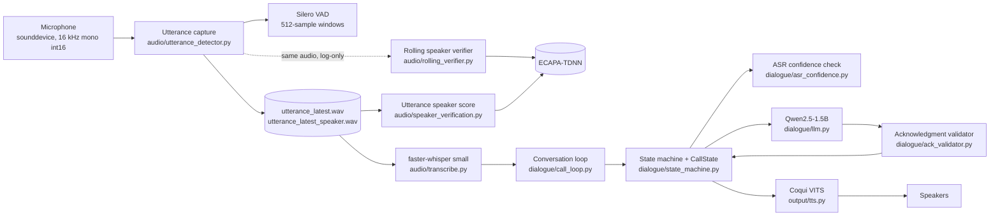

# Patient Follow-up Voice AI Agent: End-to-End Documentation

Last updated: 2026-11-11

This document describes what is actually built, file by file, with the exact models and parameters in use. Everything here was checked against the source code or the installed packages unless it is marked **(not verified)**.

---

## 1. What the project is

A local, CPU-only voice agent that conducts a short **patient follow-up phone-style conversation**:

1. Greets the patient and asks whether it is a good time.
2. Asks how they have been feeling.
3. Asks about pain or discomfort.
4. If pain is mentioned **without a specific body part**, asks where it is.
5. Closes the call.

It listens through the microphone, understands speech, decides the next question with deterministic rules, and speaks back. In parallel it compares the speaker's voice with an enrolled reference (`reference.wav`) and **only logs** the result.

**Design principles**

- The **state machine decides what to ask next**. The LLM only words a short acknowledgment.
- Speaker verification is **log-only**: it never filters, rejects, or blocks audio.
- Everything runs **locally on CPU**. No cloud calls, no database.
- Uncertain input is **re-asked**, not guessed at.

---

## 2. Pipeline and architecture



### One turn, step by step

1. `main.py` loads all models once, builds the reference embedding from `reference.wav`, and creates the `RollingSpeakerVerifier` and `DialogueStateMachine`.
2. `dialogue/call_loop.py` runs the loop. The agent speaks the current question (`agent.say()`); the microphone is **closed** during speech.
3. `listen()` in `main.py` calls `capture_one_utterance()`:
   - opens a fresh `sounddevice.InputStream`,
   - cuts the audio into 512-sample windows and asks Silero VAD whether each contains speech,
   - after about 1.5 s of silence the utterance ends,
   - the same audio is fed to the rolling verifier (log-only),
   - two WAV files are saved: a full one and a trimmed one.
4. `listen()` scores the trimmed WAV with ECAPA (log-only), then Whisper transcribes the full WAV.
5. The loop passes the text and Whisper's confidence to `DialogueStateMachine.process_response()`.
6. The state machine decides: re-ask, repeat, or accept. If accepted, it updates `CallState`, asks Qwen for an acknowledgment, validates it, speaks it, and moves to the next state.
7. The loop repeats until the state machine reaches `FINISHED`.

**Concurrency:** only one background thread exists, the rolling verifier's worker. Capture, Whisper, the LLM, and TTS run one after another. There is no barge-in; the patient cannot interrupt the agent.

---

## 3. Models and parameters (exact)

### 3.1 Software versions (read from the installed `.dist-info` folders)

| Package | Version |
|---|---|
| Python | 3.12 (virtual environment at `.venv`) |
| torch | 2.14.1 |
| torchaudio | 2.11.0 |
| faster-whisper | 1.2.1 |
| ctranslate2 | 4.8.3 |
| llama-cpp-python | 0.3.36 |
| coqui-tts | 0.28.0 |
| speechbrain | 1.1.1 |
| silero-vad | 6.2.3 |
| sounddevice | 0.5.6 |
| numpy | 2.5.4 |
| scipy | 1.18.1 |

`requirements.txt` in the repository is **empty**, so these versions are not recorded anywhere else.

### 3.2 Audio capture (`audio/utterance_detector.py`)

| Setting | Value |
|---|---|
| Sample rate | 16 000 Hz |
| Channels | 1 (mono) |
| Sample format | int16 |
| Block size from the microphone | 1 600 samples (100 ms) |
| Queue between microphone callback and loop | `Queue(maxsize=200)`; a full queue drops a chunk and counts it |
| Input device | system default (`INPUT_DEVICE` is only set in the experiment scripts) |
| Capture timeout | 30 s |

### 3.3 Voice activity detection: Silero VAD

| Setting | Value |
|---|---|
| Model | Silero VAD, loaded with `load_silero_vad()` (package `silero-vad` 6.2.3) |
| Window | 512 samples at 16 kHz (about 32 ms) |
| Speech threshold | probability >= 0.5 |
| End of utterance | 47 consecutive non-speech windows (about 1.5 s) |
| Pre-roll kept before first speech | 5 windows (about 160 ms) |
| Tail kept after last speech in the trimmed speaker WAV | 5 windows (about 160 ms) |
| State reset | `vad_model.reset_states()` at the start of every capture |

### 3.4 Speech recognition: Whisper (`audio/transcribe.py`)

| Setting | Value |
|---|---|
| Library | faster-whisper 1.2.1 on CTranslate2 4.8.3 |
| Model size | **`small`** (the multilingual Whisper small model, about 244 million parameters; faster-whisper maps it to the CTranslate2 conversion `Systran/faster-whisper-small`) |
| Device | CPU |
| Compute type | `int8` (quantised) |
| Language | forced to `en` |
| Beam size | 5 |
| Built-in VAD filter | off (`vad_filter=False`); Silero VAD in the capture loop is used instead |
| Metrics returned | `avg_logprob`, `avg_no_speech_prob`, number of segments, audio duration |

The mapping to the `Systran/faster-whisper-small` repository is how faster-whisper resolves the name `"small"`; the local download cache was not inspected **(not verified locally)**.

### 3.5 Language model: Qwen2.5 (`dialogue/llm.py`)

| Setting | Value |
|---|---|
| Model | **Qwen2.5-1.5B-Instruct** |
| File | `models/qwen2.5-1.5b-instruct-q4_k_m.gguf` (about 1 066 MB) |
| Quantisation | `Q4_K_M` (4-bit GGUF) |
| Runtime | llama-cpp-python 0.3.36 (llama.cpp) |
| Context window | `n_ctx = 2048` |
| CPU threads | `n_threads = 6` |
| GPU layers | `n_gpu_layers = 0` (CPU only) |
| Temperature | 0.3 |
| Max new tokens | 100 |
| Interface | `create_chat_completion` with one system prompt and one user message; **no conversation history** is sent |

The `models/` folder also contains `phi-2.Q4_K_M.gguf` (about 1 706 MB). `dialogue/llm.py` does not use it.

### 3.6 Text-to-speech: Coqui (`output/tts.py`)

| Setting | Value |
|---|---|
| Library | coqui-tts 0.28.0 |
| Model | **`tts_models/en/vctk/vits`** (VITS architecture, trained on the VCTK multi-speaker English corpus) |
| Speaker | `p225` |
| Output sample rate | 22 050 Hz (from the model's `config.json`) |
| Device | CPU (`gpu=False`) |
| Phonemizer | eSpeak NG, path `C:\Program Files\eSpeak NG` (hard-coded) |
| Playback | `sd.play(...)` then `sd.wait()` (blocks until finished) |

### 3.7 Speaker embeddings: ECAPA-TDNN (`audio/speaker_verification.py`)

| Setting | Value |
|---|---|
| Model | **`speechbrain/spkrec-ecapa-voxceleb`** (ECAPA-TDNN), saved in `pretrained_models/ecapa` |
| Library | speechbrain 1.1.1, `EncoderClassifier` |
| Device | CPU |
| Input features | 80 mel bins |
| Network | channels `[1024, 1024, 1024, 1024, 3072]`, kernel sizes `[5, 3, 3, 3, 1]`, attention channels 128 (from the local `hyperparams.yaml`) |
| Embedding size | 192 dimensions |
| Comparison | cosine similarity between embeddings |
| Reference | `reference.wav` (an 18.79 s recording), embedded once at start-up |

The model card describes it as trained on VoxCeleb; that was not checked locally **(not verified locally)**.

### 3.8 Speaker verification settings (`audio/rolling_verifier.py`)

| Setting | Value |
|---|---|
| Rolling window | 2.0 s |
| Check interval | every 0.5 s of audio fed |
| Threshold | **0.1** (accepted when similarity >= 0.1) |
| Threshold origin | inherited from `voiceAI_test_v5.py`; **not validated** |
| Mode | log-only |
| Inference | one background worker thread; if it is busy, the tick is skipped, never queued |

### 3.9 Dialogue settings (`dialogue/`)

| Setting | Value | File |
|---|---|---|
| Whisper unreliable thresholds | `avg_logprob < -1.0` or `avg_no_speech_prob > 0.6` (Whisper's own decode defaults) | `asr_confidence.py` |
| Whisper borderline thresholds | `avg_logprob < -0.8` or `avg_no_speech_prob > 0.4` (**placeholders, not calibrated**) | `asr_confidence.py` |
| Acknowledgment limits | at most 25 words, at most 2 sentences | `ack_validator.py` |
| No usable answer per question | 3 attempts, then close | `state_machine.py` (`MAX_UNUSABLE_ATTEMPTS`) |
| Technical failures in a row | 2, then close | `MAX_SYSTEM_ERRORS` |
| TTS failures in a row | 2, then close | `MAX_TTS_FAILURES` |

---

## 4. File-by-file walkthrough (in pipeline order)

### 4.1 `main.py`: orchestration

Loads the models once, builds the reference embedding, creates the verifier and the state machine, and hands the loop to `run_conversation`.

```python
rolling_verifier = RollingSpeakerVerifier(
    model=speaker_model,
    reference_embedding=reference_embedding,
    background=True,       # ECAPA inference off the capture loop
    require_turn=True,     # only accept audio during the patient's turn
    on_result=lambda result: print(format_result(result)),
    on_skip=lambda total_sec: print(format_skip(total_sec)),
)
agent = DialogueStateMachine()
run_conversation(agent, lambda: listen(whisper_model, speaker_model,
                                       reference_embedding, rolling_verifier), report)
```

`listen()` does capture, then the log-only speaker check, then transcription:

```python
audio_file = capture_one_utterance(verifier=rolling_verifier)
speaker_file = LAST_CAPTURE_INFO.get("speaker_path", audio_file)
similarity = verify_speaker(speaker_model, reference_embedding, speaker_file)  # log-only
result = transcribe_audio_with_confidence(whisper_model, audio_file)
```

The speaker check is wrapped in `try/except`, so a failure there never ends the call. A `finally` block calls `sd.stop()` and `rolling_verifier.end_turn()` for cleanup.

### 4.2 `audio/utterance_detector.py`: microphone, VAD, endpointing

Responsibilities: open the microphone, run Silero VAD on 512-sample windows, find the start and end of one utterance, feed the verifier, and save two WAV files.

Key points:

- The microphone callback only enqueues audio and never does heavy work.
- Before speech starts, windows go into a small pre-roll buffer so the first syllable is not cut off.
- After speech, 47 silent windows (about 1.5 s) end the utterance.
- Two files are written: `utterance_latest.wav` (full, used by Whisper) and `utterance_latest_speaker.wav` (trimmed, used by ECAPA). Copies go to `utterance_history/`.

```python
probability = get_speech_probability(frame)
is_speech = probability >= VAD_THRESHOLD          # 0.5
...
if silence_count >= SILENCE_WINDOWS:              # 47 windows, about 1.5 s
    print("End of utterance detected.")
    break
```

`capture_one_utterance(verifier=...)` calls `verifier.begin_turn()` first and `_finish_rolling()` (end the turn and print a summary) in a `finally`.

### 4.3 `audio/rolling_verifier.py`: rolling speaker check (log-only)

Keeps the last 2.0 s of audio in a buffer. Every 0.5 s of new audio it either reports `INSUFFICIENT_AUDIO` (less than 2.0 s buffered), skips the tick (an inference is still running), or runs ECAPA on a snapshot copy of the window and compares with the reference.

```python
self._buffer = np.concatenate((self._buffer, chunk))[-self._window:]
self._since_tick += chunk.size
if self._since_tick < self._step:
    return None
self._since_tick %= self._step      # at most one tick per feed
return self._tick()
```

Safety features: `require_turn` (only accepts audio between `begin_turn()` and `end_turn()`, so the agent's own voice is never analysed), an epoch counter that drops stale results, and a lock around the statistics. Output is a printed line such as `[rolling] t= 2.02s | TARGET | sim=0.4182 | infer=526 ms`.

### 4.4 `audio/speaker_verification.py`: ECAPA embeddings and cosine

```python
def load_speaker_model():
    return EncoderClassifier.from_hparams(
        source="speechbrain/spkrec-ecapa-voxceleb",
        savedir="pretrained_models/ecapa",
        run_opts={"device": "cpu"})

def compare_embeddings(reference_embedding, test_embedding):
    return F.cosine_similarity(reference_embedding, test_embedding, dim=1).item()
```

`load_audio()` converts to float, resamples to 16 kHz if needed, and trims leading and trailing silence by short-time RMS (20 ms frames, 150 ms padding). `embed_array()` does the same embedding for an in-memory array with no file I/O and no trimming; the rolling verifier uses it.

### 4.5 `audio/transcribe.py`: Whisper

```python
model = WhisperModel("small", device="cpu", compute_type="int8")
segments, info = model.transcribe(str(audio_file), language="en",
                                  beam_size=5, vad_filter=False)
```

`transcribe_audio_with_confidence()` returns the text plus the mean of each segment's `avg_logprob` and `no_speech_prob`. These two numbers feed the dialogue's confidence check.

### 4.6 `dialogue/call_loop.py`: the conversation loop

Separated from `main.py` so it can be tested with fake listening and speaking. It speaks the prompt, listens, and hands the result to the state machine. Every failure ends in one of three ways: ask again, carry on, or close with a spoken goodbye.

```python
try:
    result = listen_fn()
except Exception as error:
    traceback.print_exc()
    agent.system_error("listening", error)    # apologise and retry, or close after 2
    continue
if result is None:
    agent.handle_no_input()                   # re-ask, or close after 3
    continue
agent.process_response(result["text"], confidence)
```

### 4.7 `dialogue/state_machine.py`: the dialogue policy

States: `INTRODUCTION -> GENERAL_FEELING -> PAIN_ASSESSMENT -> (PAIN_LOCATION) -> CLOSING -> FINISHED`.

Routing is done by `choose_next_state()` from what the patient said, using simple keyword rules:

```python
if self.state in (State.GENERAL_FEELING, State.PAIN_ASSESSMENT):
    if self.mentions_pain(text):
        if self.mentions_specific_location(text):
            return State.CLOSING          # already described it
        return State.PAIN_LOCATION        # ask, never assume
    if self.state == State.GENERAL_FEELING:
        return State.PAIN_ASSESSMENT
    return State.CLOSING
```

- Pain words: pain, hurt, ache, sore, discomfort, cramp, swell, tender, stiff and similar.
- Negation patterns recognise "no pain", "not in pain", "nothing hurts", "I don't have any pain".
- "Specific location" words include ankle, toe, calf, heel, knee, back, shoulder and others. Broad words like "foot" or "leg" are deliberately **not** treated as specific, so "pain in my foot" gets the question "Could you describe exactly where the pain or discomfort is?".
- Bare "yes" or "no" is expanded using the current question (for example "No" to the pain question becomes "No, I am not experiencing any pain or discomfort.").
- Repeat requests ("could you repeat that") re-speak the question.

Inside `process_response()` the order of decisions is: empty check, repeat request, **confidence check**, content clarification, then accept (update `CallState`, acknowledge, move on). See section 5.

### 4.8 `dialogue/asr_confidence.py`

Turns Whisper's two numbers into `ok`, `borderline`, or `unreliable`. Thresholds are in section 3.9. A bare yes/no ignores the log-probability rule because short answers naturally score poorly, but is still rejected for a high no-speech probability.

### 4.9 `dialogue/llm.py`

Loads Qwen2.5-1.5B at import time and exposes `generate_acknowledgment(patient_response, question=None)`. The system prompt tells the model to give exactly one short, warm sentence, never ask a question, never give medical advice, never invent details, and never introduce a new topic. The model has no memory between turns.

### 4.10 `dialogue/ack_validator.py`

Checks the model's output before it reaches the speaker. It rejects a reply that is empty, longer than 25 words or 2 sentences, contains a question or role labels, gives advice or mentions treatment, names a body part, symptom or number the patient did not mention, has the wrong tone for the pain situation, or contains no acknowledgment wording. A rejected reply is replaced by a fixed phrase chosen by context:

| Situation | Fallback |
|---|---|
| Patient reported pain | "I'm sorry to hear that." |
| Introduction, or patient denied pain | "Thank you for letting me know." |
| After a pain location answer | "Thank you for sharing that." |
| Otherwise | "I understand." |

### 4.11 `dialogue/call_state.py`

A plain dataclass record of the call, in memory only:

```python
@dataclass
class PatientInfo:
    general_feeling: Optional[str] = None
    pain_reported: Optional[bool] = None    # None = not known yet
    pain_location: Optional[str] = None
    pain_description: Optional[str] = None

@dataclass
class CallState:
    patient: PatientInfo
    conversation_status: str = "in_progress"  # completed | ended_no_response | ended_error
    clarification_count: int = 0
    low_confidence_turns: int = 0
```

It is only updated from trusted transcripts. A borderline transcript that was accepted can fill an empty field but never overwrite a known one.

### 4.11b `output/tts.py`

Loads Coqui VITS at import time and exposes `speak(text)`, which synthesises on CPU and plays it with `sounddevice`. Playback blocks, and the microphone stream is closed while the agent speaks.

### 4.12 `evaluation/`: speaker-verification check

| File | Purpose |
|---|---|
| `evaluation/record_session.py` | Records labelled samples with the app's own capture. Label is the folder (`genuine` or `impostor`). Never overwrites files. |
| `evaluation/evaluate_speaker.py` | Scores every recording against `reference.wav` and prints a table and summary. Writes `eval_results/results.csv`. Refuses a byte-identical copy of `reference.wav`. |

Table columns: filename, actual label, similarity, TARGET/NON_TARGET at 0.1, correct/incorrect. Summary: genuine accepted/rejected, impostor accepted/rejected, accuracy, false acceptances, false rejections, score ranges, and a note on small samples. It does not compute ROC, AUC or EER.

### 4.13 Other files (not part of the live app)

`audio/vad_detector.py`, `audio/stream_buffer.py`, `audio/record_test.py`, `audio/inspect_audio.py`, and `output/test_tts.py` are experiment scripts. `audio/recorder.py` records `reference.wav` and **overwrites it without asking**. `speech/asr.py`, `speech/speaker.py`, `speech/vad.py` and `requirements.txt` are empty.

---

## 5. Dialogue behaviour in detail

### 5.1 Confidence-aware handling

```
Whisper text + (avg_logprob, avg_no_speech_prob)
        |
        v
assess_transcript()
   unreliable -> do NOT acknowledge, do NOT update CallState, re-ask (counts as an attempt)
   borderline -> ask once "could you say that once more?"; accept the second try
   ok         -> continue
```

Re-ask wording: attempt 1 is "Sorry, I didn't catch that." plus the question; attempt 2 is "Let me try once more. Could you answer in a few simple words?" plus the question; attempt 3 closes the call politely.

### 5.2 Acknowledgment pipeline

```
trusted transcript -> Qwen candidate -> validate_acknowledgment()
                                          pass -> speak it
                                          fail -> fixed fallback phrase -> speak it
```

The model never chooses the next question. A test confirms that even an LLM reply saying "Next, let's talk about your toe exercise" cannot change the state.

### 5.3 Example flows

| Patient says | Result |
|---|---|
| "I'm feeling fine." | Records the feeling, then asks about pain. |
| "I have some pain in my foot." | Records pain with no location, asks "Could you describe exactly where the pain or discomfort is?". |
| "My ankle hurts." | Records pain, location `ankle`, goes to closing. |
| "No pain." | Records `pain_reported = False`, goes to closing. |
| Mumbled audio with `avg_logprob = -1.2` | Re-asks politely; nothing recorded. |
| Silence three times | Polite goodbye, status `ended_no_response`. |

---

## 6. Speaker verification: what it is and is not

- ECAPA turns audio into a 192-number embedding; cosine similarity compares it with the reference embedding.
- The threshold **0.1 comes from the earlier sample script and has not been validated** on our recordings.
- Scores are **similarities, not probabilities**.
- It is **log-only**: no audio is filtered or discarded, and transcription always proceeds.
- Two measurements exist: the rolling 2 s window (log lines `[rolling] ...`) and one utterance-level score on the trimmed WAV. They can disagree, because the rolling window includes silence.

**Measured so far**

- Live runs (the user's own voice): utterance scores 0.2558 to 0.5602; rolling inference took about 517 to 628 ms per window on CPU.
- Offline check with `python -m evaluation.evaluate_speaker` on 12 genuine recordings: all accepted; scores min 0.2104, mean 0.4165, max 0.6247.
- **No impostor recordings exist yet**, so false acceptance has not been measured and no statement about the usefulness of 0.1 can be made.

---

## 7. Reliability: retries and errors

| Problem | Counter | Limit | Result |
|---|---|---|---|
| No usable answer to this question (silence, unclear, unreliable transcript) | per question | 3 | 1st and 2nd re-ask; 3rd closes, status `ended_no_response`. Reset after a usable answer. |
| Technical failure in capture, transcription or dialogue | consecutive | 2 | Apology and re-ask; then technical goodbye, status `ended_error`. Reset after a good turn. |
| Text-to-speech failure | consecutive | 2 | Call ends (the agent cannot speak). |
| LLM failure or invalid reply | none | n/a | Fixed fallback phrase; the call continues. |
| Speaker check failure | none | n/a | Logged and ignored (log-only feature). |
| Unclear pain answer | per call | 1 | One neutral rephrase, then move on. |

Every exception prints its traceback to the console, and the patient never hears technical details. Not capped: repeat requests ("can you repeat that").

---

## 8. Tests

Run with `python -m unittest <module names>` from the project root.

| Test file | Tests | Covers |
|---|---|---|
| `tests/test_rolling_verifier.py` | 32 | Buffer, 0.5 s interval, states, threshold, busy skip, turns, stale results |
| `tests/test_capture_integration.py` | 14 | Capture loop with a fake microphone stream |
| `tests/test_simple_evaluation.py` | 21 | TARGET/NON_TARGET rule, correct/incorrect, counts, recorder (made-up scores) |
| `tests/test_dialogue_flow.py` | 13 | Routing: fine, discomfort, foot pain, ankle, toe, no pain, yes/no, repeat |
| `tests/test_dialogue_robustness.py` | 49 | Confidence, validator, `CallState`, retry limits, failure handling |
| **Total** | **129** | All pass |

What these tests **do** prove: the logic behaves as designed, with the LLM, TTS, microphone and Whisper replaced by fakes.

What they **do not** prove: that real Whisper, Qwen, Coqui or the speaker threshold behave well in practice, and any real speaker-verification accuracy. Scores used in the evaluation tests are made-up numbers.

---

## 9. How to run

```bash
# from the project root, with the virtual environment active
python main.py

# all tests
python -m unittest tests.test_dialogue_robustness tests.test_dialogue_flow tests.test_rolling_verifier tests.test_capture_integration tests.test_simple_evaluation

# speaker evaluation
python -m evaluation.record_session --label genuine --count 12
python -m evaluation.record_session --label impostor --name spk01 --count 12
python -m evaluation.evaluate_speaker

# dialogue only, typing the patient's answers (loads Qwen and TTS)
python -m dialogue.state_machine
```

### Repository layout

```
main.py                         orchestration
audio/                          capture, VAD, ASR wrapper, speaker verification
  utterance_detector.py  rolling_verifier.py  speaker_verification.py  transcribe.py
dialogue/                       policy, confidence, validation, call state, loop, LLM
  state_machine.py  call_state.py  asr_confidence.py  ack_validator.py  call_loop.py  llm.py
output/tts.py                   Coqui TTS
evaluation/                     record_session.py  evaluate_speaker.py
eval_data/  eval_results/       recordings and results
tests/                          5 test files, 129 tests
models/                         Qwen GGUF (and an unused phi-2 GGUF)
pretrained_models/ecapa/        ECAPA-TDNN files
reference.wav                   fixed enrolled voice (never modified by the code)
```

**Version control note:** `.gitignore` ignores `audio/`, `output/`, `models/` and `pretrained_models/`, so the capture, speaker, ASR and TTS code is **not tracked by git**. The repository has a single commit.

---

## 10. Known limitations and open items

**Confirmed**

- `requirements.txt` is empty.
- Models load at import time in `llm.py`, `tts.py` and `utterance_detector.py`.
- `audio/recorder.py` overwrites `reference.wav` without a prompt.
- Patient audio is saved to `utterance_history/` with no retention limit.
- The LLM has no memory between turns.
- The validator cannot catch a transcription error that is in the patient's own text (for example "my food hurts" scores about -0.54 / 0.23, passes the confidence check, and Qwen echoed "food").

**Needs real-world testing (not verified)**

- The borderline confidence thresholds need calibration on recorded calls.
- Whether the validator is too strict or too loose with real Qwen output.
- How the new spoken re-ask and goodbye phrases sound through Coqui.
- The unreliable-transcript path has been tested only with fakes, not live.
- Whole-turn latency (end-of-speech detection plus Whisper, Qwen and TTS) has not been measured on CPU. Only the ECAPA time (about 0.5 s per window) is measured.
- Speaker verification usefulness at 0.1: needs impostor recordings.

**Possible next steps**

1. Put all source folders under version control.
2. Record impostor samples and run the evaluation before deciding what, if anything, speaker verification should do.
3. Add per-stage timing logs, then decide whether GPU use (RTX 4050) is worth it.
4. Calibrate the confidence thresholds on recorded calls.
5. Optional: a basic UI (proposed, not built).

This is a prototype. It is not a medical device and gives no diagnosis or treatment advice.
