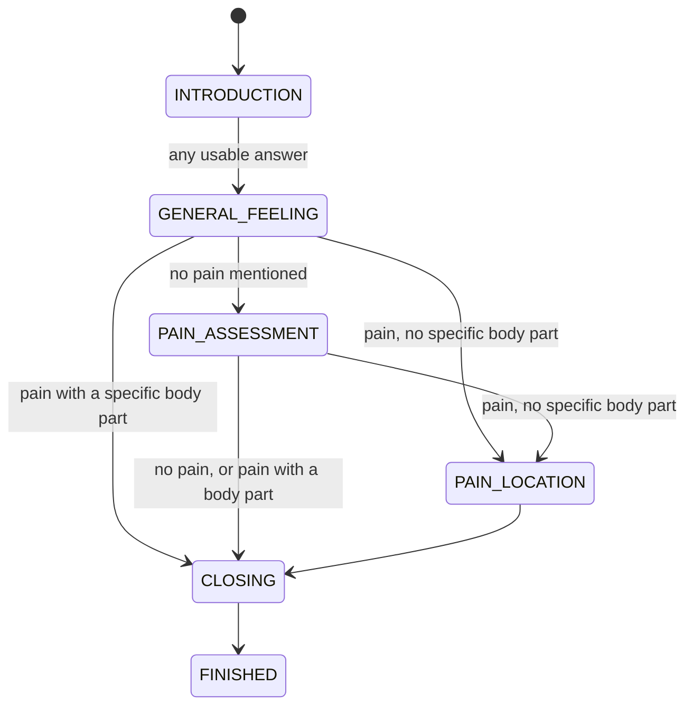

# The Dialogue State Machine Explained

File: `dialogue/state_machine.py`. Line numbers below refer to the file as it was when this was written (2026-11-11) and may drift if the file is edited.

## 1. What it is, in one sentence

The state machine is the part that decides **what the agent asks next**. It reads the patient's transcribed answer, updates the record of the call, asks Qwen only to word a short acknowledgment, and moves to the next stage. The LLM never chooses the next question.

## 2. The stages



Defined at lines 55-61. The questions are fixed strings in `self.questions` (line 121):

- INTRODUCTION: "Hello! I'm calling for your patient follow-up. Is this a good time to talk?"
- GENERAL_FEELING: "How have you been feeling recently?"
- PAIN_ASSESSMENT: "Are you experiencing any pain or discomfort?"
- PAIN_LOCATION: "Could you describe exactly where the pain or discomfort is?"
- CLOSING: "Thank you for sharing your update. Please follow your clinician's instructions. Goodbye!"

## 3. What we did, in order

1. **Original problem:** `PAIN_ASSESSMENT` always led to three hard-coded states, ANKLE_EXERCISE, TOE_EXERCISE and CALF_EXERCISE, through a fixed `next_state` dictionary. The patient's answer was never used to choose the next stage, so the agent introduced body parts the patient never mentioned.
2. **Fix 1, context-aware flow:** we removed the three exercise states and added `PAIN_LOCATION`. A new `choose_next_state()` reads the answer. We also removed the toe-exercise example from the LLM prompt in `dialogue/llm.py`.
3. **Fix 2, Whisper confidence:** `process_response()` now receives Whisper's two confidence numbers and re-asks instead of acting on an unreliable transcript.
4. **Fix 3, LLM validation:** every Qwen reply is checked before TTS and replaced by a fixed phrase if it fails.
5. **Fix 4, `CallState`:** a structured record of what the patient told us.
6. **Fix 5, retry limits and error handling:** silence, unclear speech, technical errors and TTS failures all have limits and end with a polite goodbye.

## 4. The code, section by section

### Settings (lines 20-53)

```python
MAX_UNUSABLE_ATTEMPTS = 3   # no usable answer to one question
MAX_SYSTEM_ERRORS = 2       # technical failures in a row
MAX_TTS_FAILURES = 2        # speech failures in a row
```

Plus the fixed re-ask and goodbye messages. These are named constants, so they can be tuned in one place.

### Keyword rules (lines 66-94)

- `PAIN_WORDS`: pain, hurt, ache, sore, discomfort, cramp, swell, tender, stiff, throb.
- `NO_PAIN_PATTERNS`: "no pain", "not in pain", "nothing hurts", "I don't have any pain".
- `SPECIFIC_LOCATIONS`: ankle, toe, calf, heel, knee, back, shoulder and others. **"Foot" and "leg" are deliberately left out**, so "pain in my foot" is treated as not specific and gets the location question.
- No medical interpretation is done: it only recognises words.

### Reading the answer (lines 170-210)

`choose_next_state()` is the heart of the flow:

```python
if self.state in (State.GENERAL_FEELING, State.PAIN_ASSESSMENT):
    if self.mentions_pain(text):
        if self.mentions_specific_location(text):
            return State.CLOSING            # already described it
        return State.PAIN_LOCATION          # ask, never assume
    if self.state == State.GENERAL_FEELING:
        return State.PAIN_ASSESSMENT
    return State.CLOSING
return self.next_state[self.state]
```

`mentions_pain()` first checks the negation patterns, so "no pain" does not count as pain. A bare "yes" or "no" is expanded by `interpret_response()` (line 247) using the current question, so "No" to the pain question becomes "No, I am not experiencing any pain or discomfort."

### Speaking safely (lines 262-286)

`say()` wraps TTS. A failure is logged with a traceback and counted. After 2 failures in a row the call ends, since the agent cannot talk.

### Retries and errors (lines 290-349)

- `_reask()` handles "no usable answer". Attempt 1 says "Sorry, I didn't catch that" plus the question. Attempt 2 says "Let me try once more…" plus the question. Attempt 3 closes the call with status `ended_no_response`.
- `handle_no_input()` is called when nothing was heard.
- `system_error()` handles technical failures, with one apology and retry, then a technical goodbye. The patient never hears exception text.

### `CallState` (lines 353-397)

`update_call_state()` records the patient's feeling, whether pain was reported, the location and a description. Only trusted transcripts reach it. A borderline transcript that was accepted may fill an empty field but never overwrite a known one (the `uncertain` flag). "I'm not sure" never overwrites a location. The record itself is in `dialogue/call_state.py`.

### Acknowledgments (lines 401-430)

`acknowledge()` asks Qwen, then runs `validate_acknowledgment()`. If the LLM raises an error or the reply is invalid, it uses `fallback_acknowledgment()`, a fixed phrase chosen by context. Only a valid reply is spoken.

### Main entry (lines 434-530)

`process_response(response, confidence)` decides in this order:

1. Empty transcript: re-ask.
2. Repeat request ("could you repeat that"): re-speak the question and return.
3. **Confidence check:** `assess_transcript()` returns ok, borderline, or unreliable.
   - Unreliable: re-ask, record nothing, no acknowledgment.
   - Borderline: ask once "could you say that once more?", then accept the second try.
4. Expand a bare yes/no.
5. Unclear answer to the pain question: one neutral rephrase.
6. A usable answer: reset retry counters, update `CallState`, get the acknowledgment, speak it.
7. Choose the next state. Reaching `CLOSING` normally sets the status to `completed`.

## 5. A real example from our run

| Patient said (as transcribed) | What the state machine did |
|---|---|
| "Yes." | INTRODUCTION to GENERAL_FEELING |
| "I have been feeling good resetting." | recorded the feeling, went to PAIN_ASSESSMENT |
| "No, I'm not feeling any pain on this comfort." | recognised "not feeling any pain" as a denial, recorded `pain_reported = False`, went to CLOSING, status `completed` |

Earlier runs: "my food hurts" gave PAIN_LOCATION, and "My ankle hurts" gave CLOSING with location `ankle`.

## 6. Honest limitations (say these before sir asks)

- **It is keyword-based.** It can miss unusual phrasings. A reply not recognised as pain simply moves to the next stage.
- **A confident wrong transcript gets through.** Whisper's confidence can't catch "resetting" for "recently". Qwen then echoed it ("resetting has been helpful") and the validator allowed it, because the word was in the patient's own text.
- **Known issues not fixed yet:**
  - `FINE_PATTERN` matches "no" or "well" anywhere in a sentence, so "I have no idea" counts as "fine".
  - The "unclear pain answer" follow-up is allowed once per call, not once per question.
  - Repeat requests are not capped.
- **The confidence thresholds** (-1.0 and 0.6 from Whisper's defaults, -0.8 and 0.4 as placeholders) need calibration on real calls.
- **The LLM has no memory across turns**, and there is no red-flag or escalation logic.
- **Testing:** 49 + 13 tests cover this file with fake models. They show the logic works as designed, not that real speech behaves well.

## 7. A 90-second spoken version

> "The state machine has five stages: introduction, general feeling, pain assessment, an optional pain-location question, and closing. After every answer, code decides the next stage: if the patient mentions pain without a specific body part, we ask where; if they name a body part or say no pain, we close. We removed the old fixed ankle, toe and calf questions. Before acting on an answer we check Whisper's confidence and re-ask if it's unreliable. Qwen only words a one-sentence acknowledgment, and we validate it and fall back to a fixed phrase if it fails. We record what the patient said in a structured CallState, and there are retry limits so a silent patient or a technical failure ends the call politely instead of looping."
