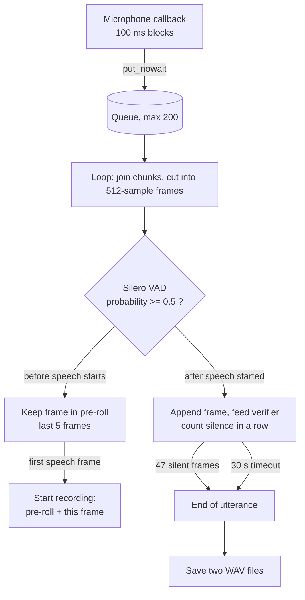
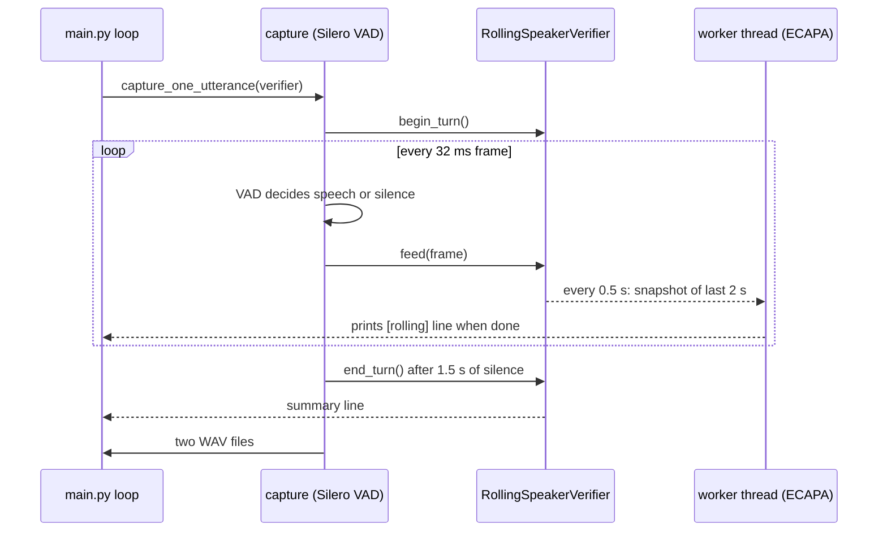

# VAD, Utterance Capture and the Rolling Speaker Verifier Explained

Files covered:

- `audio/utterance_detector.py` (microphone, Silero VAD, end-of-utterance detection)
- `audio/rolling_verifier.py` (the 2-second rolling speaker check)

Line numbers refer to the files as they were on 2026-11-11 and may drift if the files are edited.

---

## Part A. Voice activity detection and utterance capture

### A1. What problem it solves

Whisper needs one complete utterance as a file. The microphone gives a continuous stream. So something has to decide **when the patient starts talking and when they have finished**. That is the job of `capture_one_utterance()` together with Silero VAD.

VAD means **voice activity detection**: a small neural network that looks at a short slice of audio and says how likely it contains human speech.

### A2. Settings (lines 20-48)

| Setting | Value | Meaning |
|---|---|---|
| `SAMPLE_RATE` | 16 000 Hz | Required by Silero VAD, Whisper and ECAPA |
| `CHANNELS` | 1 | Mono |
| `CHUNK_SIZE` | 1 600 samples (100 ms) | Block size delivered by the microphone callback |
| `VAD_WINDOW_SIZE` | 512 samples (about 32 ms) | One slice given to Silero VAD, as the model requires at 16 kHz |
| `VAD_THRESHOLD` | 0.5 | A slice with probability >= 0.5 counts as speech |
| `SILENCE_WINDOWS` | 47 | 47 x 32 ms, about **1.5 s** of silence ends the utterance |
| `PRE_ROLL_WINDOWS` | 5 | About 160 ms kept before the first speech slice |
| `SPEAKER_TAIL_WINDOWS` | 5 | About 160 ms kept after the last speech slice in the trimmed speaker WAV |
| `CAPTURE_TIMEOUT` | 30 s | Give up if nothing happens |
| Queue | `Queue(maxsize=200)` | Buffer between the microphone callback and the loop |

Silero VAD is loaded once at import (`load_silero_vad()`, package version 6.2.3) and its state is reset at the start of every capture with `vad_model.reset_states()`.

### A3. The flow, step by step



1. **The microphone callback only enqueues audio.** No heavy work runs inside it. If the queue is full, the chunk is dropped and counted (`dropped_chunks`), which is shown as "Dropped audio chunks" in the log (0 in all our runs).
2. **The loop cuts the stream into exact 512-sample frames.** Leftover samples are carried over to the next chunk (`pending_audio`).
3. **Each frame goes to Silero** through `get_speech_probability()` (lines 84-94), which converts int16 to float and runs the model under `torch.inference_mode()`.
4. **Before speech has started**, frames go into a 5-frame rolling `pre_roll` buffer. This is what keeps the first syllable from being cut off.
5. **At the first frame with probability >= 0.5**, recording starts. The pre-roll plus that frame become the beginning of the recording, and the same audio is given to the rolling verifier.
6. **After that**, every frame is appended, and `silence_count` counts frames in a row that are not speech. Any speech frame resets it to 0.
7. **When `silence_count` reaches 47** (about 1.5 s), the utterance is over.

The key lines:

```python
probability = get_speech_probability(frame)
is_speech = probability >= VAD_THRESHOLD          # 0.5
...
if is_speech:
    silence_count = 0
else:
    silence_count += 1
if silence_count >= SILENCE_WINDOWS:              # 47 windows, about 1.5 s
    print("End of utterance detected.")
    break
```

### A4. What gets saved (`save_utterance`, lines 97-162)

Two files are written each time, plus timestamped copies in `utterance_history/`:

| File | Content | Used by |
|---|---|---|
| `utterance_latest.wav` | Everything, including the 1.5 s of trailing silence | Whisper |
| `utterance_latest_speaker.wav` | From the start up to the last speech frame plus 5 tail frames | ECAPA utterance-level speaker score |

Only speech frames are counted in "VAD speech duration". For example, in the last run the "Yes" answer was 2.08 s in total, but only 0.45 s was speech.

`LAST_CAPTURE_INFO` (a module-level dictionary) records the file paths, durations, dropped chunks and the rolling summary so that `main.py` can read them.

### A5. How it connects to the rolling verifier

`capture_one_utterance(verifier=...)` (lines 186-208):

1. calls `verifier.begin_turn()` before listening (fresh window, fresh counters),
2. runs the capture loop, feeding every recorded frame to `verifier.feed()`,
3. in a `finally` block calls `_finish_rolling()` (lines 211-229): `end_turn()`, wait for the last inference, print the summary.

`_feed_verifier()` (lines 169-183) wraps the call in `try/except`: if the verifier fails, the error is printed once and the capture continues. **The verifier only receives a copy of the audio and can never change what is recorded.**

### A6. Honest limitations of this part

- **The end-of-utterance wait is 1.5 s.** Published voice-agent settings with Silero alone are typically about 0.5 to 0.8 s, and LiveKit's Silero default is 0.55 s. Ours is safer against cutting a patient off, but adds about a second per turn. We have not measured pause lengths in real answers, so we haven't tuned it.
- **A pause longer than 1.5 s in the middle of an answer ends the utterance early.** VAD detects sound, not whether the sentence is finished.
- **There is no minimum speech length.** One frame at or above 0.5 starts a recording, so a loud click could trigger one. It then gets filtered later (no usable transcript).
- **The 0.5 threshold is the Silero default**, not tuned on our microphone or room.
- **Capture is one thread** and the VAD runs per frame on the main loop. It has been fast enough in our runs (0 dropped chunks), but we have not measured the load.

---

## Part B. The rolling speaker verifier

### B1. What problem it solves

We want a running estimate of whether the voice in the call matches the enrolled voice in `reference.wav`, **while the patient is speaking**, without delaying the conversation. It follows the scheme in the sample script `voiceAI_test_v5.py`.

### B2. The idea in one picture

```
audio stream ->  [ ...older audio... | last 2.0 s ]   (rolling buffer)
                                         |
                every 0.5 s of new audio |
                                         v
                       ECAPA embedding -> cosine similarity vs reference.wav
                                         |
                              >= 0.1 ?   TARGET   else   NON_TARGET
                                         |
                              printed as a log line only
```

**It only reports. It never discards, trims or filters audio, and it cannot stop transcription.** Its module docstring says so, and every similarity is an uncalibrated cosine value, not an identity probability.

### B3. Settings (lines 26-33)

| Setting | Value | Origin |
|---|---|---|
| `WINDOW_SEC` | 2.0 s | `SPEAKER_WIN_SEC` in `voiceAI_test_v5.py` |
| `STEP_SEC` | 0.5 s | One check per 0.5 s block in the same script |
| `SIMILARITY_THRESHOLD` | **0.1** | `SPEAKER_SIM_THRESH` in the same script. **Not validated on our data.** |
| Rule | similarity >= threshold gives TARGET | Inclusive comparison |
| Model | ECAPA-TDNN (SpeechBrain `spkrec-ecapa-voxceleb`) on CPU | |

### B4. The three possible results (lines 36-41)

| State | When | Meaning |
|---|---|---|
| `TARGET` | A full 2 s window was scored and similarity >= 0.1 | Consistent with the reference at this (unvalidated) threshold |
| `NON_TARGET` | A full window was scored and similarity < 0.1 | Not consistent at this threshold. **Not proof of a different speaker.** |
| `INSUFFICIENT_AUDIO` | Fewer than 2.0 s buffered | No decision at all, for example during a short "yes" |

### B5. The code, piece by piece

**Feeding audio, `feed()` (lines 184-210)**

```python
self._buffer = np.concatenate((self._buffer, chunk))[-self._window:]   # keep last 2.0 s
self._total_samples += chunk.size
self._since_tick += chunk.size
if self._since_tick < self._step:       # step = 0.5 s = 8000 samples
    return None
self._since_tick %= self._step
return self._tick()
```

- The buffer is always capped to the last 2.0 s.
- Time is counted in **samples fed**, not wall-clock time, so the result is the same whatever the processing speed.
- At most **one** tick happens per `feed()` call, so a large chunk never causes a backlog of catch-up checks.

**One tick, `_tick()` (lines 291-335)**

1. Count the tick.
2. If an inference is still running, **skip this tick** (never queue it) and call `on_skip`.
3. If less than 2.0 s is buffered, report `INSUFFICIENT_AUDIO`.
4. Otherwise take a **snapshot copy** of the window, mark the verifier busy, and start one worker thread (`background=True`) that runs the check. `feed()` returns immediately, so the capture loop is never blocked.

**The inference, `_run()` (lines 337-379)**

```python
embedding = self._embed_fn(window)                     # ECAPA, about 0.5 s on CPU
similarity = float(compare_embeddings(self._reference, embedding))
state = TARGET if similarity >= self.threshold else NON_TARGET
```

- Any exception is caught and counted as an error, because this module is log-only and must never break the caller.
- The result is dropped if its **epoch** no longer matches (see B6).
- `finally` clears the busy flag.

**Turn control (lines 212-246)**

- `begin_turn()` resets the buffer and counters and starts accepting audio.
- `end_turn()` stops accepting audio, waits up to 2 s for the last inference, and returns the statistics.
- With `require_turn=True` (as used in `main.py`), audio is only accepted **between** `begin_turn()` and `end_turn()`. This keeps the assistant's own voice and all non-patient time out of the window.

### B6. Safety features and why they exist

| Feature | Why |
|---|---|
| Background worker thread | ECAPA takes about 0.5 s; running it inside capture would drop microphone audio |
| Snapshot copy of the window | Later `feed()` calls replace the buffer; the worker must never read changing data |
| Skip, never queue, busy ticks | Prevents a growing backlog and overlapping inferences |
| Epoch counter | A slow inference from an earlier turn cannot leak its result into the next turn |
| Lock around statistics | The worker and the capture loop both touch them |
| `require_turn` gate | The agent's TTS audio is never analysed |
| Errors only counted | Log-only: a failure must not affect the call |

### B7. Reading the real log

From our latest run (the feeling answer, 3.36 s total):

```
[rolling] t= 0.51s | INSUFFICIENT_AUDIO | sim=n/a
[rolling] t= 1.02s | INSUFFICIENT_AUDIO | sim=n/a
[rolling] t= 1.50s | INSUFFICIENT_AUDIO | sim=n/a
[rolling] t= 2.53s | tick SKIPPED (previous inference still running)
[rolling] t= 2.02s | TARGET             | sim=0.6272 | infer=556 ms
[rolling] t= 3.01s | TARGET             | sim=0.2852 | infer=528 ms
          ticks=6 | inferences=2 | TARGET=2 | NON_TARGET=0 | INSUFFICIENT_AUDIO=3 | skipped=1 | errors=0
```

How to read it:

- **`t=` is audio time already fed** (seconds since the turn began), not clock time. Ticks land on multiples of the 32 ms frame, so they show as 0.51, 1.02, 1.50 and so on.
- **Three INSUFFICIENT_AUDIO lines**: the first three ticks happen before 2.0 s of audio exists.
- **The line `t=2.53 SKIPPED` appears before the `t=2.02` result.** The inference started at 2.02 s takes about 0.55 s on a background thread. By the time it finishes, the next tick (2.53 s) has already fired and found it busy, so it was skipped. The `t=2.02` result is printed when the worker finishes, hence out of order.
- **Inference (about 520 to 630 ms) is slightly longer than the 0.5 s step**, so on CPU one tick per turn is skipped, which matches `skipped=1` in the summaries. The effective rate is therefore about one check per second, not two per second.
- **The last window is the lowest** (0.2852, and 0.2492 in the next turn). It covers audio that includes the 1.5 s of trailing silence the capture waits for, so it contains little speech. This is consistent with the data but is a hypothesis, not a proven cause.

### B8. Real numbers so far

| Measurement | Values |
|---|---|
| Rolling scores, own voice, in this run | 0.1529, 0.6272, 0.2852, 0.5858, 0.5037, 0.2492 |
| Rolling range seen across runs | about 0.085 to 0.63 |
| Inference time | about 514 to 628 ms |
| Utterance-level scores (trimmed WAV) | 0.2558 to 0.6003 in live runs; 0.2104 to 0.6247 over 12 recorded files |
| Impostor scores | **none measured** |

### B9. Honest limitations of this part

- **The threshold 0.1 is unvalidated.** It is the original script's value. SpeechBrain's own default threshold is 0.25. Without impostor recordings, we cannot say whether 0.1 separates anyone.
- **Short answers get no rolling score at all.** "Yes" and "No" are under 2 s, so they only produce INSUFFICIENT_AUDIO or a window mostly made of silence. The utterance-level score is used for those.
- **The window includes silence and pre-roll**, which lowers and destabilises the score (see B7).
- **Two scores exist** (rolling and utterance-level) and can disagree. For one "Yes" they were 0.1529 and 0.3165.
- **Duration mismatch:** the reference is 18.79 s long, while test audio is 0.5 to 3 s. Research says short test audio lowers verification accuracy. We have not yet tested chunked or averaged enrollment.
- **It is log-only on purpose.** It does not reject anyone, and its results do not influence the dialogue.

---

## Part C. How the two parts work together



The VAD decides **where the utterance begins and ends**. The rolling verifier watches the **same audio** during that time and only logs. Whisper and the dialogue never wait for it.

---

## Part D. A 90-second spoken version

> "Audio comes from the microphone in 100 millisecond blocks into a queue. We cut it into 32 millisecond frames and ask Silero VAD whether each one is speech, with a threshold of 0.5. We keep 160 milliseconds before the first speech frame so the first syllable isn't lost, and we end the utterance after about 1.5 seconds of silence. We save a full recording for Whisper and a trimmed one for the speaker check.
>
> The rolling verifier follows your sample script. It keeps the last two seconds of the same audio and, every half second, computes an ECAPA embedding and compares it with the enrolled reference using cosine similarity, with your threshold of 0.1. It runs in a background thread so capture is never blocked, it skips a check if the last one is still running, and it's log-only: it never filters or rejects audio. The scores in our runs ranged from about 0.09 to 0.63 for my own voice. We haven't recorded impostors yet, so we can't claim the threshold is valid."

---

## Part E. Likely questions

**Why 512 samples?** Silero VAD at 16 kHz requires exactly 512-sample windows (about 32 ms).

**Why wait 1.5 seconds for the end?** To avoid cutting off patients who pause. Published voice-agent defaults are shorter (about 0.5 to 0.8 s for Silero alone), so we could reduce it, but we haven't measured our patients' pauses.

**Does the verifier delay the conversation?** No. It runs in a background thread, and the capture loop only gives it copies of the audio. At the end of a turn we wait at most 2 s for the last inference.

**Why are some ticks skipped?** ECAPA takes about 0.5 to 0.6 s on CPU, which is slightly more than the 0.5 s step. A tick that finds the previous inference still running is skipped, never queued.

**Why "INSUFFICIENT_AUDIO"?** The window needs 2.0 s of audio. Short answers like "yes" never reach that. It is not evidence of a different speaker.

**Can it reject a speaker?** No. It is log-only by design. Filtering would need evidence from genuine and impostor recordings first.

**Where does 0.1 come from?** From the original script (`SPEAKER_SIM_THRESH`). It is not validated.

**What is the epoch counter for?** If an inference from one turn finishes late, the epoch changed at the next `begin_turn()`, so its result is discarded and cannot appear in the wrong turn.
